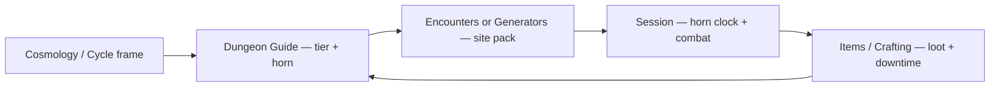

# World / Dungeon Loop — Collaborator GM Guide

**Product:** Decennium Descent companion (TTRPG-first)  
**Scope:** How tiers, encounters, crafting, cosmology, and Session tab connect for a table session  
**Canon sources:** `floor-encounters.json`, `dungeon-mechanics.json`, `cosmology-lore.json`, `crafting-recipes.json`, rulebook extracts  
**Last updated:** 2026-07-29 (Overnight Worker)

---

## One-session loop (at the table)

| Phase | Companion tab | GM use |
|-------|---------------|--------|
| **Frame the Cycle** | Cosmology · Dungeon Guide (Overview) | Remind players: 10-year Shardspire rotation, Opening **2400 h** / Horn PoNR **1200 h (day 50)**; soft quit Floor 50 Canticle ≠ Horn; tiers 1–5 mapped / 6–10 rumor |
| **Pick depth** | Dungeon Guide · Encounters · Generators | Select tier; read gate boss, havens, POIs |
| **Build the scene** | Encounters · Generators | Filter POIs/havens or roll encounter pack; **Load in Session** |
| **Run combat & clock** | Session | Tier selector, horn countdown, initiative, bestiary pull, Add Gate Boss |
| **Loot & crafting** | Items · Crafting | Match salvage to workbook recipes; experimental combine in workbench |
| **Return or descend** | Dungeon Guide | Gate boss defeated → next tier; horn blown → ascent or 10-year trap |

---

## Data wiring (what matches what)

### Tier bands & gate bosses

**Live source of truth:** `src/data/floor-encounters.json` + `src/data/dungeon-mechanics.json` → `gateBosses[]`

| Tier | Floors | Zone | Gate boss | Mapped in UI |
|------|--------|------|-----------|--------------|
| 1 | 1–10 | Yieldheart Caverns | Vaskor, the Stone Maw | yes |
| 2 | 11–20 | Bloomdeep Marsh | The Bloom That Hungers | yes |
| 3 | 21–30 | Anvil of Brogi | Ashthirst the Hollow | yes |
| 4 | 31–40 | Isles of Eternal Radiance | Gor Vekk, Architect of Ends | yes |
| 5 | 41–50 | Sanctum of Echoing Choirs | Choralith, Voice Below | yes |
| 6 | 51–60 | Crossroads of the Shattered Thread | Lumen of the Shattered Thread | **rumor stub** |
| 7 | 61–70 | Pactbound Arena | Xarog, the Pactbound Furnace | **rumor stub** |
| 8 | 71–80 | Duskshard Pools | Eirfax, the Dusk Crowned | **rumor stub** |
| 9 | 81–90 | Veiled Iron Spiral | Threxus, the Iron Spiral | **rumor stub** |
| 10 | 91–100 | Silencebound Void | The Marquis of Silence | **rumor stub** |

Tiers **1–5** have full haven/POI prose from Floor Encounters.docx. Tiers **6–10** have survivor-rumor stubs (1 haven + 2 POIs each, derived from tier prose) — treat as **GM improv seeds**, not playable map canon.

### Horn & Cycle

- **Decennial opening window:** **100 days / 2400 hours** once the Shardspire activates — then the descent seals ([`DESCENT_WINDOW_CANON.md`](./DESCENT_WINDOW_CANON.md)).
- **Horn PoNR:** at **1200 hours / day 50** a giant horn sounds; retreat or risk **10 years** trapped until next Cycle (`hornRule`; `HORN_AT = 1200` in `SessionTracker.tsx`). Soft quit at Floor 50 Canticle ≠ Horn.
- **10-year rotation:** Shardspire activates; dungeon layout can reshape; expedition structure and horn rule stay.
- **Expedition structure (RAW):** up to **12 characters** per Expedition, five teams (Combat 4–6, Recon 1–3, Research 1–3, Resource 2–4, Support 1–3), **morning / afternoon / evening** periods — full rulebook prose in [`EXPEDITION_STRUCTURE_CANON.md`](./EXPEDITION_STRUCTURE_CANON.md); JSON subset in `dungeon-mechanics.json`; Session UI is combat-only today.
- Session tab tracks elapsed hours and shows horn progress bar.

### Cosmology ↔ dungeon (approved links)

Use [`CONTINUITY_GLOSSARY.md`](../../src/data/CONTINUITY_GLOSSARY.md) for terms. Safe connections **without inventing lore**:

| Cosmology term | Dungeon touchpoint |
|----------------|-------------------|
| **Shardspire / Tenfold Cycles** | Why the Decennium reshapes; Cycle naming after victors |
| **Great Descent** | 100 floors, 10 tiers |
| **Choir / Echo Court** | Tier 5 Sanctum of Echoing Choirs; Choralith gate boss |
| **Hush Beneath the Song** | Tier 10 Silencebound Void; Marquis of Silence |
| **Turning Spiral** (patron) | Distinct from **Veiled Iron Spiral** (tier 9 zone) — name collision; clarify at table |
| **Brogi** (Plane of Fire echo) | Tier 3 Anvil of Brogi |
| **Binding of the Old God (Level 97)** | Deepest myth anchor; not a mapped encounter tier |

### Crafting ↔ dungeon

- **623 recipes** in `crafting-recipes.json` (validated workbook ingest).
- **Components library** derives from bestiary loot tiers (`bestiary_data_full.json`) — zone drops tie monsters to salvage.
- **Items tab:** browse dropped + crafted catalog; **Crafting tab:** recipe catalog + experimental workbench.
- **Generators → Loot spark:** random recipe name + tier-scaled gp salvage hint for quick table flavor.
- **Session handoff (thin):** **Log loot in Session** on crafted/dropped item detail appends the item line to Session scene notes via `pushLootHandoff()` in `session-handoff.ts` (same tab-switch pattern as Encounters). No tier/brief overwrite — append-only.

### Encounter → Session handoff

1. In **Encounters** or **Generators**, build or view a tier scene → click **Load in Session**.
2. Open **Session** tab — pending pack applies: **tier**, **gate boss label**, and **scene brief** (stored in `localStorage` via `src/lib/session-handoff.ts`).
3. Use **Add Gate Boss** in Session for tier-scaled stub HP (`40 + tier×25`); pull real stats from **Monsters** bestiary as needed.

---

## Collaborator GM checklist

Before running a Decennium session for other GMs:

### Pre-session (15 min)

- [ ] Read horn rule aloud from Dungeon Guide or Session banner.
- [ ] Confirm party tier target (most tables stop at tier 5 — **Bar of Last Refuge** is the narrative turn-back pressure).
- [ ] Load saved characters in Session (Characters tab → SAVE first).
- [ ] Skim tier POIs/havens in Encounters for the chosen tier.
- [ ] Note gate boss name for the tier — defeat unlocks deeper tiers in fiction.

### During session

- [ ] Advance horn clock (+1h exploration, long rest +8h) in Session.
- [ ] Track per-character RP and optional party pool in Session (Weave spend flavor — not Oracle RC).
- [ ] Pull monsters from bestiary search into initiative.
- [ ] Flag any content marked **Unmapped rumor** in UI — improvise or use Generators hooks.

### After session

- [ ] Log loot against Items/Crafting recipes if players craft between delves.
- [ ] Note continuity questions in ASK OWNER below — **do not retcon canon in the companion**.

---

## Draft & rumor content (show players honestly)

| Content | Status | UI signal |
|---------|--------|-----------|
| Tiers 1–5 encounters | Rulebook / Floor Encounters ingest | Full POI + haven lists |
| Tiers 6–10 encounters | **Rumor stubs** — 1 haven + 2 POIs from tier prose | `Unmapped` badge, survivor-rumor note in Dungeon Guide |
| Cosmology First Song | Single blob; chapter nav incomplete | Generators / Cosmology viewer |
| Cosmology XIV gate boss list | **Superseded** — use floor-encounters for play | `[superseded by Dungeon Guide]` in Cosmology viewer |
| `dungeon-mechanics.json` entryClasses / victoryConsequences | **Director draft** — 17 CANON_CLASSES eligible; tier-themed `byTier` consequences | `draft: true` badge in data; author review before canon |
| Crafting workbench “Test Crafting” | **Experimental** — not workbook canon | GM discretion only |

---

## ASK OWNER — blockers (do not invent lore)

**Protocol:** If dungeon, cosmology, and crafting data conflict, **stop** and escalate. Do not merge lists or rewrite bosses to “make it fit.” Record the discrepancy against [`CONTINUITY_SOURCE_OF_TRUTH.md`](./CONTINUITY_SOURCE_OF_TRUTH.md) and escalate it rather than inventing a merge.

| # | Blocker | Evidence | Status |
|---|---------|----------|--------|
| **WDL-1** | **Cosmology XIV gate bosses vs dungeon tiers** | `cosmology-lore.json` XIV subsections: Hollow King (Lv10), Cindervore (Lv30), Vox Prime (Lv70). Live table: Vaskor T1, Ashthirst T3, Xarog T7, etc. | **RESOLVED, now FORMAL (owner lock round 2, 2026-07-30, Q7)** — "Use bestiary names for gate guardians (live roster). Formally retire older Velkyrion/Zeharra/Kharix-style cosmology names where they conflict." Use `floor-encounters.json` / Dungeon Guide for play; Cosmology XIV list and World-of-Aethel god-as-combat-figure names are retired, not just draft-flagged. |
| **WDL-2** | **Cycle entry classes & victory consequences** | Was placeholder bullets; now `entryClasses.eligible` (17 CANON_CLASSES) + `victoryConsequences.byTier` (floor-encounters themes) | **RESOLVED (Director draft 2026-07-29 overnight)** — `draft: true` in JSON; re-open if rulebook Ch XII source specifies class restrictions |
| **WDL-3** | **Tier 6–10 POI/haven content** | Was empty; now rumor stubs from tier prose | **RESOLVED (stub)** — Generators hooks + GM improv until author ingest |
| **WDL-4** | **Level 97 Old God vs tier/floor math** | Myth cites Level 97; tiers are 10-floor bands to 100 | Treat as cosmology myth, not encounter index — **ASK OWNER** if a floor-97 room gets authored |

**Escalation path:** Worker → Director docs → Owner (lore author). Never force continuity in UI copy.

---

## File map (Worker C ownership)

| File / surface | Role |
|----------------|------|
| `src/components/DungeonGuide.tsx` | Cycle, tiers, mechanics, gate boss reference |
| `src/components/EncountersBrowser.tsx` | Haven/POI browse + Session handoff |
| `src/components/GeneratorsPanel.tsx` | Encounter packs, hooks, loot sparks + Session handoff |
| `src/components/SessionTracker.tsx` | Horn, tier, initiative, handoff consumer |
| `src/components/ItemsLibrary.tsx` / `CraftingBuilder.tsx` | Loot + recipes |
| `src/components/CosmologyViewer.tsx` | Planes + world lore (superseded flags on conflicts) |
| `src/lib/session-handoff.ts` | Encounter pack bridge + loot append bridge |
| `src/lib/session-utils.ts` | Director session defaults (RP, RC, HP, rest, initiative) |
| `src/data/floor-encounters.json` | Tier narrative + bosses |
| `src/data/dungeon-mechanics.json` | Cycle, expedition teams, gate boss index |
| `src/data/crafting-recipes.json` | Official recipe catalog |

---

## Related docs

- [`src/data/CONTINUITY_GLOSSARY.md`](../../src/data/CONTINUITY_GLOSSARY.md) — approved terms  
- [`CONTINUITY_SOURCE_OF_TRUTH.md`](./CONTINUITY_SOURCE_OF_TRUTH.md) — current canon gates and precedence  
- [`../MECHANICS_ROADMAP.md`](../MECHANICS_ROADMAP.md) — current development roadmap  
- [`docs/mechanics/SESSION_LOOP.md`](SESSION_LOOP.md) — Session tab Director defaults
- [`docs/mechanics/EXPEDITION_STRUCTURE_CANON.md`](EXPEDITION_STRUCTURE_CANON.md) — 12-person expedition RAW (owner lock 2026-07-30)
