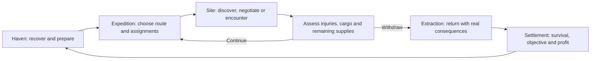

# Decennium Descent game design evaluation for Unity

17 October 2026 · Design evaluation · Owner and development reference

**Unity is decided. How the game plays is the decision now.** The camera, control model, visual style, platforms, multiplayer model and first playable scope remain open. The earlier Windows / 3D / overhead-camera question is retained for discussion; no answer is assumed.

My recommended direction for evaluation is a **party-command RPG with turn-based encounters, an expedition map and a Haven hub**. This gives the existing expedition, extraction and consequence systems a clear player interface. A hero-led experience and a hybrid deserve comparison before that recommendation becomes the design baseline.

This assessment proposes presentation and production choices. Existing source mechanics retain their authority. Substantive changes to those mechanics require their own explicit decision. No Unity project, gameplay implementation or new game rules are created by this assessment.

## The experience the game should deliver

The central promise is to lead people into the Descent, discover something worth recovering, and decide what can safely come home. Combat consumes the time, health and resources needed for the return. Survival, completing an objective and earning a profit are separate outcomes. Haven settlement makes those outcomes affect the next expedition.

The design should make five recurring choices compelling:

1. What objective is worth the commitment, and whom should we bring?
2. Which route, preparation or negotiation reduces the risk?
3. What should each character do when danger interrupts the plan?
4. When should we retreat, and what cargo or rescue takes priority?
5. How should recovery, crafting, obligations and discoveries change the next departure?

These priorities follow the [design doctrine](../../DescentReviewChanges/ReviewBible/docs/mechanics/DESIGN_DOCTRINE.md), [gameplay loop](../../DescentReviewChanges/ReviewBible/docs/mechanics/GAMEPLAY_LOOP_CANON.md) and [reviewed expedition procedures](../../DescentReviewChanges/ReviewBible/docs/mechanics/expedition/EXPEDITION_PLAYER_BOOK.md). The [video-game directive](../../DescentReviewChanges/ReviewBible/docs/mechanics/VIDEO_GAME_ONLY_DIRECTIVE.md) makes software responsible for exact bookkeeping while preserving meaningful complexity.

## Three ways to experience the same game

These are product directions, not engine alternatives. All three use Unity. Relative production burdens below are design judgments, not measured estimates.

| Direction | What the player does | Fit with the existing game | Main design burden |
|---|---|---|---|
| **Party command** | Select characters, position the group, choose actions, assign expedition work and manage recovery | Strong fit with explicit turns, multiple characters, cargo and expedition offices | Make a large party readable and avoid excessive menus or long waits |
| **Hero led** | Directly move one protagonist, explore at character height and issue companion orders | Strong personal presence; still compatible with turn-based battles if combat changes mode | Define companion agency, precise targeting, off-camera threats, party switching and the protagonist's relationship to the company |
| **Hybrid** | Explore with a selected leader, then use a tactical camera and party control in encounters | Can combine personal exploration with the existing action economy | Two control models, camera transitions, exploration-to-combat placement and twice the interaction testing |

**Recommendation:** use party command as the baseline to challenge, and use the hybrid as the strongest alternative if inhabiting the world personally is central to the owner's vision. Choose hero-led play if identification with one protagonist matters more than directing the company moment to moment.

A third-person camera does not require real-time action combat. An overhead camera does not require an always-visible grid. Decide player authority, combat timing and camera independently, then test whether the combination is comfortable.

### Combat timing

| Model | Consequence for Decennium Descent | Evaluation |
|---|---|---|
| Turn-based encounters | Preserves regular turns, reactions, Ready, action costs and six-second round markers | Recommended starting point; test pace, reaction prompts and large encounters |
| Real time with pause | Needs explicit interpretation of simultaneous orders, reaction windows, queued movement and existing turn ownership | Plausible only after the translation rules are designed and reviewed |
| Direct action combat | Requires decisions about aiming, dodging, animation timing and the relationship between player skill and authored checks | A substantial combat redesign; evaluate only if this is the intended player experience |

The [combat integration](../../DescentReviewChanges/ReviewBible/docs/mechanics/COMBAT_ACTION_PLAYTEST.md) refreshes ordinary reactions at regular own-turn starts and distinguishes extra turns from regular markers. The [resolution integration](../../DescentReviewChanges/ReviewBible/docs/mechanics/CORE_RESOLUTION_PLAYTEST.md) gives attacks, tasks and saves different procedures. A generic action-RPG controller cannot silently replace those contracts.

## How the three play modes connect

### Haven

Recommend a compact hub with visible people and services, supported by clear settlement and preparation screens. The player's important actions are choosing objectives, recruiting or assigning people, buying real supplies, resolving claims, recovering and commissioning work.

A menu-only Haven reduces content cost but may weaken attachment to the company. A fully traversable city adds walking, navigation, characters and animation before the core loop is proven. Compare those experiences with a small hub layout before deciding the final scale.

Show a settlement breakdown that explains debts, shares, losses and retained goods. Keep successful withdrawal, objective completion and profit separately visible. A player should understand why a successful fight did not necessarily produce a successful expedition.

### Expedition travel

Recommend a route map for long travel and assignments, with local spaces for meaningful sites. Routes should retain knowledge, hazards, capacity, travel costs and return conditions. Repeated travel should have consequences without requiring the player to walk every uneventful stretch.

The alternative is continuous exploration of the dungeon. It offers stronger spatial continuity, but requires a design for compressing long travel, showing distributed teams, and preserving the eight-hour Watch framework. This is a major content and pacing commitment, not simply a camera change.

**Open timing decision:** specify when travel advances simulation time, when inspection pauses it, and how an encounter interrupts and resumes an assignment. The Opening's 2,400 hours, Horn at hour 1,200, eight-hour Watches and encounter clocks must share one chronology. They are fictional elapsed time, not a requirement that players wait in real time. No compression ratio is selected here.

### Local encounters

Recommend authored spaces where positioning, sight, obstacles, rescue and retreat are understandable. The first environment should offer a meaningful exit and an objective beyond defeating every enemy.

Use movement previews, action costs, target validity and visible consequences to teach the system. Display only information the characters are entitled to know. Explain an unavailable action in player language; let the player inspect the relevant rule when needed.

Animation and camera movement should communicate resolved actions. They must not grant extra range, delay a deadline or change an outcome when animation speed changes.

## Party control and the protagonist

The reviewed expedition rules allow up to **12 member characters** and suggest a **4–6-person combat team**. These are not equivalent to a universal four-character battle limit. [Source](../../DescentReviewChanges/ReviewBible/docs/mechanics/expedition/EXPEDITION_PLAYER_BOOK.md#fl-02).

For evaluation, use four controllable characters to keep the first walkthrough manageable. That is a proposed test fixture, not a change to the expedition cap or a claim that only four people can enter danger. Later tests must include larger groups and companions.

Settle these questions together:

- Is the player the company, a persistent protagonist, or a leader who can be replaced?
- Who can be directly controlled, and when may control switch?
- Where are other teams physically located during an encounter, and what happens if they are attacked?
- Which commands may companions execute automatically, and when must the player decide?
- What happens to the campaign after a protagonist dies or a company loses its expedition?

Recommendation for the first design pass: direct control of the active party, explicit assignments for other members and optional automation for repetitive authorized actions. Keep companions' actual ownership, command costs and permissions intact. Avoid treating off-screen members as invulnerable or granting them free contributions.

Single-player and cooperative play remain separate product decisions. If cooperative play is essential, decide shared time, pause, dialogue authority, character ownership, split parties and disconnect handling before architecture is fixed. A solo evaluation fixture does not settle the shipping mode.

## Camera, space and visual direction

The retained camera question should be evaluated with the same encounter layout under each candidate view: a rotatable overhead view, a character-following view, and a hybrid transition. Compare target selection, identifying an exit, tracking companions, seeing height changes and reading a rescue action.

Recommend a stylized 3D treatment for evaluation, emphasizing silhouettes, traversable surfaces, cargo and readable effects. Photorealism and a 2D or 2.5D treatment remain alternatives. Detailed art direction follows the camera and readability decision.

The rules already include five-foot tiles, equal orthogonal/diagonal movement cost in the current combat candidate, body space and Tiny occupancy requiring finer measurement. Exact geometry also matters for spells and bodies. [Combat](../../DescentReviewChanges/ReviewBible/docs/mechanics/COMBAT_ACTION_PLAYTEST.md); [body and equipment](../../DescentReviewChanges/ReviewBible/docs/mechanics/BODY_EQUIPMENT_PLAYTEST.md).

**Proposed presentation:** optional grid and range overlays over a readable environment. Keep the authored movement metric even if the grid is hidden. Before engineering, specify units, vertical movement, footprint occupancy, range measurement, cover, line of effect and area intersections. Smooth-looking movement is not permission to replace every distance rule with Euclidean distance.

The [Asset Lab README](../../Descent%20assets/README.md) explicitly describes ripped disc inputs. Their presence is not evidence of production reuse rights. Treat that collection as a separate reference experiment until individual rights are documented. Use original, licensed or primitive material for the proposed prototype; asset selection remains open.

## The player interface and pacing

Evaluate five connected screens before producing a polished HUD:

| Screen | Main player decision | Information needed |
|---|---|---|
| Expedition preparation | Commit to an objective and risk limits | Members, roles, actual supplies, transport, obligations and return limits |
| Route and assignment view | Choose progress, work, rest or withdrawal | Known route state, assignment conflicts, elapsed time, provisions and uncertainty |
| Encounter view | Commit a legal action | Selected actor, initiative, remaining resources, path, targets, reactions and exits |
| Cargo and casualty view | Decide what can return | Physical handling, actual weight, Load, capacity, priority and exposure |
| Haven settlement | Pay obligations and prepare again | Arrival outcome, costs, shares, recovery, remaining inventory and opportunities |

Use a small number of visible primary actions with details available on demand. Action previews should distinguish known results, probability and genuinely unknown information. Do not leak hidden resistance or unrevealed enemies through previews.

Reaction handling is a key pacing experiment. Compare always asking, configurable automatic responses and a mixed policy. Automatic responses must be limited by the same legal triggers and resources. Measure whether players understand a declined or spent reaction; do not assume fewer prompts always improves play.

Accessibility belongs in these early evaluations: scalable text, keyboard navigation, remapping, color-independent markers, adjustable camera movement, readable targeting, subtitles and controllable animation pace. Controller support and minimum screen size need explicit target decisions.

## The first complete playable loop to design

**Proposed test slice:** one compact Haven, one expedition objective, two route choices, one local encounter site, one meaningful cargo/casualty decision, extraction and settlement. Use a small legal selection of existing character options. Exact class, creature, item and spell IDs must be selected from their operative sources before implementation.

The slice should support both continuing toward the objective and choosing an early withdrawal. It should preserve a consequential resource change through return, settlement, save and reload. Optional harvesting or one craft can demonstrate the economy if its prerequisites fit the slice; a full crafting catalogue is unnecessary to test the loop.

The fixture needs authored encounter behavior, objective completion/failure, retreat, surrender or negotiation where supported, and bounded responses to supported interactions. Historical Director discretion is an unresolved software-design task: encounter authoring must specify those responses. Do not assume a generative AI Director will supply missing rules.

Proposed success evidence, to agree before testing:

- Players can explain their objective, the reason to retreat and the consequence of their cargo choice.
- Target selection, action cost and reaction prompts are understandable without developer intervention.
- The same cargo, injury and resource records persist through all three modes without duplication.
- Early withdrawal is legible as a valid outcome, with its own costs and benefits.
- Settlement changes the next preparation decision.
- Replaying the same legal commands and random inputs produces the same rules outcome.

Record decision time, prompt count, mistaken clicks, questions and confusion points. Set numerical pacing and usability thresholds after the first observed walkthrough; no invented target duration or untested balance claim is needed now.

## Unity responsibilities after the design is chosen

The proposed implementation boundary is a rules simulation separated from presentation. Commands request legal actions; rules resolve costs, ordering, random inputs and state changes; Unity presents the result through scenes, animation, audio and UI. All modes use the same authoritative campaign state.

| Responsibility | Proposed design requirement |
|---|---|
| Rules and time | Explicit ordered events, regular-turn markers, deadlines, interruption and cleanup |
| Content | Stable existing IDs, source/version bindings, review scope, dependencies and visibility |
| State and saves | Character state, inventory/custody, injuries, assignments, route state, obligations, clocks, effect lifecycles and RNG state |
| Geometry | Explicit rule queries for movement, bodies, ranges and effects; visual navigation cannot decide their semantics implicitly |
| Enemy and encounter behavior | Validated legal commands, bounded objectives, awareness, morale and retreat rules |
| Player presentation | Camera, input, previews, effects and summaries that observe the simulation |
| Authoring tools | Content validation, scenario setup, encounter definitions and reproducible test inputs |

Use exact quantities and stable ordering where rules require them. Define the random generator, command ordering and save compatibility deliberately. Unity's fixed-step scheduling alone does not establish the project's required replay behavior; that is an engineering requirement to verify. [Unity fixed updates](https://docs.unity.com/en-us/engine/6000.3/manual/scripting/managing-time-and-frame-rate/fixed-updates).

If the 3D scalable presentation is selected, evaluate URP first. Unity documents URP for scalable 2D/3D rendering and HDRP for high-fidelity 3D on higher-end platforms; pipeline choice should follow the art and hardware targets. Exact Editor version and packages remain unselected. [Unity pipeline comparison](https://docs.unity3d.com/6000.0/Documentation/Manual/choose-a-render-pipeline.html).

Plan rules tests separately from scene/input tests and target-player tests. Unity supports Editor, Play mode and standalone-player test execution. [Unity testing](https://docs.unity.com/en-us/engine/6000.3/manual/programming-environment/test-framework-introduction/running-tests). Existing authored examples still need conversion to executable assertions; their historical check counts are not Unity runtime results.

## Readiness and source reconciliation

The main source is `C:\Github\DecenniumDescent`. The inspected material is a substantial rules/content collection and companion application, with no verified Unity project root. Do not treat the Documents audit workspace or the separate Asset Lab as the game implementation.

| Evidence inspected | Current finding | Design implication |
|---|---|---|
| Video-game directive | Deterministic computer RPG; intentional turn/round rules remain | Evaluate digital presentation without silently redesigning mechanics |
| Character foundation | 17 class foundations; explicitly not a complete character runtime schema | Build the state model and acquisition flow before broad content import |
| Equipment candidate | 220 items, 7 packs, 17 class kits and 20 background mappings | Good source for a selected fixture; quantity, capacity and availability still need runtime handling |
| Public recipe review catalogue | 433 source recipes, all 433 reviewed in the catalogue's stated authored scope | Select a coherent subset; review does not prove gameplay economy or executable behavior |
| Current spell index | 848 identities; 465 reviewed authored entries, 383 remaining | Preserve separate authored, implemented, tested and player-enabled states |
| Interface registry 03 | 78 entries with individual scope/status records | Reuse exact scoped interfaces; do not blanket-certify every entry |
| Coverage ledger | 75 areas, 74 marked open and 1 closed | This is a work-scope ledger, not a percentage of game production completed |

The start page and the ledger's embedded spell summary still show 451 reviewed / 397 pending. The current index, inventory 02 and AC6 acceptance receipt instead support 465 / 383. The receipt records authored acceptance of 14 spells and explicitly records no runtime implementation. Its acceptance authority, review archive, submitted archive, reply and complete-envelope hashes were checked against the referenced local files for this assessment. This is a bounded reconciliation, not a new semantic approval or full source audit.

See [source evidence](SOURCE_EVIDENCE.json) for exact inspected paths and hashes. Refresh that snapshot before freezing an implementation baseline. Current recommendations do not change the original sources or their review statuses.

## Decisions before project setup

| Order | Decision | Proposed direction | Status |
|---|---|---|---|
| 1 | What does the player embody and control? | Expedition/party command, with hybrid exploration as the alternative to test | Open |
| 2 | How does combat advance? | Existing turn-based rules | Open product choice; current mechanics remain in force |
| 3 | How do travel and local exploration connect? | Route map plus playable sites | Open |
| 4 | How does the camera support those controls? | Compare overhead, following and hybrid views | Earlier question retained |
| 5 | Solo or cooperative product? | Solo fixture for evaluation; shipping model must be decided | Open |
| 6 | Which platforms, inputs and visual quality? | Windows/keyboard/mouse and stylized 3D as one candidate | Earlier platform question retained |
| 7 | How do time, reactions, saves and failure feel? | Explicit time advance, tested reaction policy, resumable state | Open; authored consequences preserved |
| 8 | What is the first complete slice? | Haven → expedition → encounter → extraction → settlement | Proposed |
| 9 | What can the team actually produce? | Establish available people, budget, asset strategy and target hardware before estimating | Unknown |
| 10 | Which Unity version, pipeline and packages? | Pin after the preceding design and production choices | Deferred |

## Work sequence

1. **Evaluate the experience.** Walk the same expedition scenario through party-command, hero-led and hybrid presentations. Compare where player attention goes and which decisions become difficult.
2. **Choose the design baseline.** Record camera/control, combat, travel, party, multiplayer, platform and failure/save choices with their reasons. The current camera question stays open until answered.
3. **Design the slice.** Produce screen flows, a simple level plan, an encounter specification, exact content IDs, state transitions and test cases. Resolve only mechanics that the slice actually needs.
4. **Prepare Unity.** Select and pin the Editor and packages, establish source control, create the project and validate the content pipeline against the chosen baseline.
5. **Build and observe the complete loop.** Use simple geometry and a small content set. Test rules, presentation and human comprehension separately, then revise the design.

The next conversation should settle the intended player experience first. Unity setup and broad content production follow that decision.
