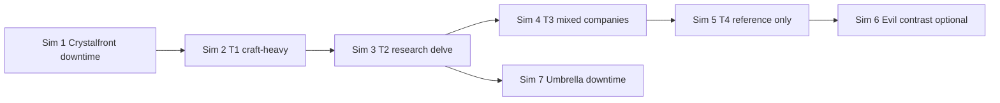

# Simulation campaign plan — Decennium Descent (full ecosystem)

**Campaign ID:** `SIM-CAMP-2026-07`  
**Workspace:** `DecenniumDescent-main`  
**Scope:** Continuing DM-simulator runs that exercise **non-combat-only** loops — tradeskills, crafting, research, expedition team splits, reputation, resonance, dungeon/horn, prestige hooks — alongside selective combat probes.  
**Ruleset default:** Resonance Hybrid-B · draft XP · excel-sandbox bestiary combat where fights occur  
**Continuity:** Builds on fringe playtest `EXP-BGR-01` and tri-company T4 run `EXP-IER-T4-01`; does **not** re-run T4 R2.

**Roster vs RAW:** Rulebook caps each **Expedition at 12 characters** ([`EXPEDITION_STRUCTURE_CANON.md`](../mechanics/EXPEDITION_STRUCTURE_CANON.md)). Campaign sims #1–#4 used **7–8 PCs** (valid). T4 sims used **24 PCs (3×8)** as a **director/playtest coalition exception** — model as coordinated sub-expeditions, not a rules change. Historical play reports are not rewritten.

---

## Ecosystem inventory (real paths)

| Domain | What exists | Primary paths |
|--------|-------------|---------------|
| **Tradeskills / crafting** | 623 validated recipes across 16 skills; component library from bestiary loot; experimental workbench | `src/data/crafting-recipes.json` · `src/components/CraftingBuilder.tsx` · `src/components/ItemsLibrary.tsx` (Crafting + Dropped tabs) · `scripts/reparse-crafting.mjs` |
| **Crafting skills (16)** | Alchemy, Blacksmithing, Cooking, Enchanting, Fishing, Herbalism, Jewelcrafting, Leatherworking, Mining, Poisoncrafting, Rune Carving, Salvaging, Scribing, Skinning, Tailoring, Tinkering | Derived from `crafting-recipes.json` (`skill` field) |
| **Research** | Expedition **Research team** (1–3); artifact/lore/ID function; Academic Factions rep; Diligent Researcher feat (draft) | `src/data/dungeon-mechanics.json` (`expedition.teams`) · `src/data/feats.js` (`diligent_researcher`) · `src/data/reputation.js` (Academic Factions) · `docs/mechanics/RESONANCE_CANON.md` (Academic spell-cost hook) |
| **Bestiary** | 718 monsters; zone loot tiers; Session import; combat sandbox | `src/bestiary_data_full.json` · `src/components/MonstersLibrary.tsx` · `docs/mechanics/BESTIARY_INGEST.md` · `docs/mechanics/MONSTER_COMBAT_SCHEMA.md` · `Bestiary_combat_sandbox.README.md` |
| **Resonance** | RP pools, retune/full harmony, overcast stub, Oracle RC exception, rep modifiers | `src/data/resonance-economy.js` · `docs/mechanics/RESONANCE_CANON.md` · `docs/mechanics/RESONANCE_MODELS.md` · `docs/playtest/RESONANCE_CHEATSHEET.md` |
| **Dungeon / horn / tiers** | T1–5 mapped POIs/havens; T6–10 rumor stubs; Horn PoNR **1200h / day 50** (Opening **2400h**); gate bosses; Cycle lore | `src/data/floor-encounters.json` · `src/data/dungeon-mechanics.json` · `src/components/DungeonGuide.tsx` · `docs/mechanics/WORLD_DUNGEON_LOOP.md` |
| **Expedition structure** | Max 12 PCs split across Combat / Recon / Research / Resource / Support; morning–afternoon–evening periods | [`EXPEDITION_STRUCTURE_CANON.md`](../mechanics/EXPEDITION_STRUCTURE_CANON.md) · `src/data/dungeon-mechanics.json` (`expedition`) |
| **Prestige** | 18 paths, requirements parser, lorebook | `src/data/prestige.js` · `src/data/prestige-lorebook.json` · `src/components/PrestigeRequirements.tsx` · `src/lib/prestige-utils.ts` |
| **Session tools** | Horn clock, initiative, RP/RC, rest, conditions, scene notes, encounter handoff | `src/components/SessionTracker.tsx` · `src/lib/session-utils.ts` · `src/lib/session-handoff.ts` · `docs/mechanics/SESSION_LOOP.md` |
| **Encounters / generators** | Tier POI/haven browser; random packs; Load in Session | `src/components/EncountersBrowser.tsx` · `src/components/GeneratorsPanel.tsx` · `src/data/floor-encounters.json` |
| **Reputation** | Four Resonance tracks on character save; Builder panel | `src/data/reputation.js` · `src/components/ReputationPanel.tsx` · `docs/mechanics/REPUTATION.md` |
| **Cosmology frame** | Cycle / Shardspire / First Song context for GM briefing | `src/data/cosmology-lore.json` · `src/components/CosmologyViewer.tsx` · `src/data/CONTINUITY_GLOSSARY.md` |
| **Prior playtests** | Fringe T1–2 combat · T4 tri-company · persona sheets · friction log | `docs/playtest/EXPEDITION_*` · `docs/playtest/T4_*` · `docs/playtest/characters/P*.md` · `docs/playtest/EXPEDITION_FRICTION_LOG.md` |

### Hidden dungeon equation

**[`HIDDEN_DUNGEON_EQUATION.md`](./HIDDEN_DUNGEON_EQUATION.md)** — repo synthesis doc (2026-07-30). **Not the owner's secret design** — their real hidden equation + counterpoint are **not uploaded yet**. Sims use a **playtest composite only** for horn/EV/XP hour tables until owner canon arrives; label accordingly in play reports.

---

## Campaign arc (narrative thread)

A single Concord contract line — **“Map the Warded Gate before the Bloom claims F11”** — links surface fringe success (`EXP-BGR-01`) to proper gate descent. Sims advance one tier band at a time while **holding characters and loot forward** (narrative continuity; no automated save merge).

---

## Simulation queue

| # | ID | Status | Output file |
|---|-----|--------|-------------|
| **1** | `SIM-CF-T1-01` | **Complete** — see play report | [`SIM_01_CRYSTALFRONT_PLAY_REPORT.md`](./SIM_01_CRYSTALFRONT_PLAY_REPORT.md) |
| **2** | `SIM-T1-CRAFT-02` | **Complete** — see play report | [`SIM_02_T1_CRAFT_PLAY_REPORT.md`](./SIM_02_T1_CRAFT_PLAY_REPORT.md) |
| **3** | `SIM-T2-RES-03` | **Complete** — see play report | [`SIM_03_T2_RESEARCH_PLAY_REPORT.md`](./SIM_03_T2_RESEARCH_PLAY_REPORT.md) |
| **4** | `SIM-T3-MIX-04` | **Complete** — see play report | [`SIM_04_T3_MIXED_PLAY_REPORT.md`](./SIM_04_T3_MIXED_PLAY_REPORT.md) |
| **5** | `SIM-T4-R2-REF` | **Done elsewhere** — do not re-run | [`T4_EXPEDITION_PLAY_REPORT.md`](./T4_EXPEDITION_PLAY_REPORT.md) |
| **6** | `SIM-EVIL-05` | **Skipped** — owner gate | — |
| **7** | `SIM-UMB-06` | **Complete** — see play report | [`SIM_06_UMBRELLA_DOWNTIME_PLAY_REPORT.md`](./SIM_06_UMBRELLA_DOWNTIME_PLAY_REPORT.md) |

---

### Sim #1 — Crystalfront bridge (T1 gate mouth)

| Field | Value |
|-------|-------|
| **Goal** | Convert fringe veterans into a gate-ready company: Crystalfront Market downtime, Luminous Vein harvest, Spire of Whispers research, light F1–3 probe, Warded Gate glyph intel — **without** clearing Vaskor. |
| **Systems exercised** | Expedition team split · Crystalfront + Hearth havens · Mining/Herbalism/Salvaging/Tinkering · Academic + Arcane rep · one patrol combat · Session horn (partial 120h) · Generators/Encounters handoff · Items loot log |
| **Success metrics** | (1) ≥2 crafted consumables from harvested mats · (2) Research team produces **Warded Gate glyph sequence** (3 of 4 runes) · (3) Horn ≤24h at sim end · (4) ≤1 PC downed · (5) Friction log entries for downtime UI gaps |
| **Output** | `SIM_01_CRYSTALFRONT_PLAY_REPORT.md` |

---

### Sim #2 — T1 craft-heavy (Floors 1–10 attrition prep)

| Field | Value |
|-------|-------|
| **Goal** | Full **Resource team** rotation through Abandoned Stoneworks + Automaton salvage; craft gate-kit (rope, salves, reinforced picks) before F4–10 unmanned zone. |
| **Systems exercised** | Blacksmithing · Salvaging · Alchemy · bestiary construct loot → components · Hearth of Yieldheart long rest · reputation (Religious Orders for Helga) · Session long rest +8h horn |
| **Success metrics** | (1) ≥5 recipe completions logged · (2) Party enters F4 with combined AC/HP buffer ≥15% vs Sim #1 end state · (3) Document which recipes lack component rows in JSON · (4) One non-combat hazard (Echoing Gallery) resolved without combat |
| **Output** | `SIM_02_T1_CRAFT_PLAY_REPORT.md` |

---

### Sim #3 — T2 research expedition (single company 6–8)

| Field | Value |
|-------|-------|
| **Goal** | One company (6–8) delves Bloomdeep F11–15 with **Research team ≥2**; Overgrown Reliquary artifact chain; Reedcaller’s Circle signal discipline. |
| **Systems exercised** | Research team · Scribing · Mirrorsage/Oracle RC · Phantom Mire recon · Rootlight Sanctuary · Academic Factions rep · **`HIDDEN_DUNGEON_EQUATION.md` if present** for horn vs research-hour tradeoff |
| **Success metrics** | (1) Artifact ID success on reliquary cache · (2) Map through F15 delivered · (3) Horn ≤48h · (4) Spore hazard table call documented · (5) Oracle RC spend tracked separately from RP |
| **Output** | `SIM_03_T2_RESEARCH_PLAY_REPORT.md` |

---

### Sim #4 — T3 mixed companies (Anvil of Brogi)

| Field | Value |
|-------|-------|
| **Goal** | Two sub-teams (Combat 4 + Resource/Support 4) rotate through Hammerfall Hall and Gearspark Forge; test `dungeon-mechanics.json` team sizes at heat-tier attrition. |
| **Systems exercised** | Mixed company handoff · Cooking/Blacksmithing at forge haven · combat on molten terrain · prestige unlock **narrative probe** (Brogi smith NPC) · overcast/Burnout in Session |
| **Success metrics** | (1) Forge-crafted item used in combat same day · (2) Zero horn violations with realistic rest cadence · (3) Team-split confusion logged · (4) At least one prestige requirement line validated against live feats |
| **Output** | `SIM_04_T3_MIXED_PLAY_REPORT.md` |

---

### Sim #5 — T4 R2 (reference only)

| Field | Value |
|-------|-------|
| **Goal** | **Already simulated** — Isles of Eternal Radiance tri-company (`EXP-IER-T4-01`). Campaign references continuity (Sunward Lance roster overlap) but **does not re-run**. |
| **Systems exercised** | See [`T4_EXPEDITION_PLAY_REPORT.md`](./T4_EXPEDITION_PLAY_REPORT.md) |
| **Success metrics** | N/A — use T4 watch docs for balance/continuity follow-up |
| **Output** | `T4_EXPEDITION_PLAY_REPORT.md` · `T4_WATCH_*.md` · `T4_ISSUES_LOG.md` |

---

### Sim #6 — Evil-alignment contrast (author gate)

| Field | Value |
|-------|-------|
| **Goal** | Mirror Sim #3 with **Evil/Neutral** party on Murk-adjacent fringe or taint-research track; compare Resonance affinity/opposition and Academic vs Religious rep friction. |
| **Systems exercised** | Alignment cost formula · `UMBRIN_LORE.md` · Crimson Agent or Mirrorsage evil build · reputation hated/disliked tiers · optional necromancy RP costs |
| **Success metrics** | (1) Document ≥3 alignment-specific RP cost deltas vs Sim #3 · (2) Table comfort with evil PC in expedition · (3) Author sign-off if content touches restricted factions |
| **Output** | `SIM_05_EVIL_CONTRAST_PLAY_REPORT.md` |
| **Gate** | Run only after author confirms evil-PC playtest scope |

---

### Sim #7 — Umbrella tradeskill downtime (floor transitions)

| Field | Value |
|-------|-------|
| **Goal** | Between-tier **umbrella camp** (surface or haven): full morning/afternoon/evening schedule from `expedition.timePeriods`; no mandatory combat — stress craft queue backlog and horn opportunity cost. |
| **Systems exercised** | All 16 tradeskills (rotation) · Fishing/Cooking camp meals · horn clock idle burn · Generators loot spark · Session scene-notes-only mode |
| **Success metrics** | (1) 3 time periods × 2 days simulated · (2) Horn opportunity cost stated in hours · (3) **`HIDDEN_DUNGEON_EQUATION.md` applied if available** · (4) Minimum viable downtime rules proposal |
| **Output** | `SIM_06_UMBRELLA_DOWNTIME_PLAY_REPORT.md` |

---

## Cross-sim tracking

| Tracker | Path |
|---------|------|
| Campaign plan (this file) | `docs/playtest/SIM_CAMPAIGN_PLAN.md` |
| Per-sim play reports | `docs/playtest/SIM_*_PLAY_REPORT.md` |
| Friction / UX log | Append to `docs/playtest/EXPEDITION_FRICTION_LOG.md` or per-sim **Friction** sections |
| Balance / continuity watches | `docs/playtest/T4_WATCH_*.md` pattern for tier-specific issues |
| Issues backlog | `docs/mechanics/AUTHOR_REVIEW_QUEUE.md` |

---

## Sim #1 handoff → Sim #2

**Carry forward:** Luminous shard stock (8 units) · Mechanical Part ×4 · Warded Gate partial glyph map · Company at L4 · Horn **19 h** underground · Academic Factions +1 (Saffron’s publishable notes) · Known gap: crafting recipes with empty `components[]` require table-assigned salvage.

## Sim #2 handoff → Sim #3

**Carry forward:** Gate-kit (7 crafts) · Warded Gate **open** · Luminous ore ×9 · Map through F10 · Company **L5** · Horn **58.5 h** cumulative · Echoing Gallery protocol proven.

## Sim #3 handoff → Sim #4

**Carry forward:** **Heartroot Surveyor’s Seal** (artifact ID) · Map through **F15** · Reedcaller signal doctrine v1 · Horn **98.5 h** (**21.5 h buffer** — mandatory long rest before T3) · Oracle RC ledger validated · Academic Factions +2 cumulative.

*Last updated: 2026-07-30 — Sims #1–#4 complete.*

## Sim #4 handoff → Sim #5+

**Carry forward:** **Fireguard Warhammer** · soot-mask rivets ×4 · F24 anvil swing map · Horn **118 h** (**2 h buffer** — do not enter T4 without surface recall or author equation) · Forge Master / "Third Hammer" prestige seed · Gate-kit depleted (Mechanical Part ×0).

## Sim #4 handoff → Sim #7 (Sim #6 skipped)

**Trigger:** Forced retreat at 118 h · extraction +2 h → **120 h banked** at Crystalfront surface (horn paused).

## Campaign end state (Sim #7)

**Carry forward:** Concord research packet **filed** · camp craft stock replenished · horn **120 h banked / paused at surface** · **0 h re-entry buffer** · Academic Factions +3 narrative · Sim #6 evil contrast **not run** (owner gate) · Sim #5 T4 remains reference-only (`T4_EXPEDITION_PLAY_REPORT.md`).

*Last updated: 2026-07-30 — Sims #1–#4, #7 complete; #6 skipped.*
