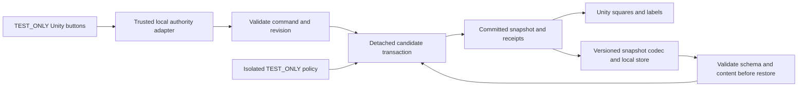
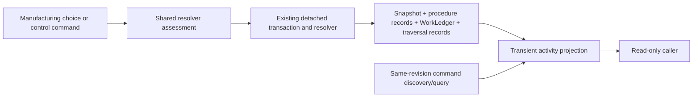

# C# gameplay simulation: architecture boundaries and historical Stage 0 assessment

**Historical C# checkpoint, 2026-11-05 (superseded):** the project was already on Engine and contained the shared simulation layers. The known schema42 harvest-manifest failures at that checkpoint were subsequently addressed; they are not current failures.

**Current architecture checkpoint, 2026-11-06:** commit `b39ee1cc` is pushed to the `Engine` branch. Schema51 observation acceptance covers observer isolation, geometry/anchor validation, shared-clock traversal through an exposed sight interval with exact save/restore and replay, processor-level Hidden clearing only for an observer who briefly sees, atomic attack rejection through a known effect blocker, and latching an already-known target Invisible episode through unseen tactical movement and save/restore. The focused Invisible case passes 1/1; the full C# 9 warnings-as-errors suite passes 1,177/1,177; static package validation passes 18/18 (237 assets and 237 GUIDs). Hidden-clearance remains processor-seam coverage and does not prove one legal trace from tactical Hide through encounter exit to exploration movement. Other Invisible episode edges and attack-evidence/reaction behavior remain open; the visual-only agreement supplies no event-sensory channel for a hidden attacker in this fixture. The owner authorized the current GPT review packet; it is prepared but not transmitted after two browser-capture timeouts. General exploration interactions, arbitrary production content and the complete engine remain incomplete. See the [current handoff](DEVELOPMENT_HANDOFF.md), [implementation trace](IMPLEMENTATION_TRACE.md), and [observation evidence](evidence/2026-11-06-observation/README.md).

**Current rule map:** [IMPLEMENTATION_TRACE.md](IMPLEMENTATION_TRACE.md) routes all 75 existing source areas into 49 work items against source revision `46a4d52728ee6956f0bebcb5d2103ffd5bc67ba4`. The map covers rule conversion and dependencies; it does not claim that all source rules or systems are implemented. Continue across the mapped exploration, tactical, and resource-management dependencies without promoting TEST_ONLY content.

Assessment date: 2026-10-20 America/Chicago. Execution evidence timestamps use UTC. This is a historical Stage 0/Stage 1 assessment; current implementation status is maintained in the handoff and trace.

## Product direction

The owner direction is a tactical CRPG with direct-control exploration, tactical combat and companion-driven resource management over one shared simulation. Turn-based combat is selected for the first prototype; the final game's combat mode remains reserved. The owner explicitly directed a C#-first engine, with presentation integration only after the C# engine is complete. Existing laboratory controls and authored fixtures remain TEST_ONLY; they are not production game content.

The supplied [development brief](DEVELOPMENT_BRIEF.md) is preserved byte-for-byte. Its execution instruction authorizes this bounded technical increment even though older authoring handoffs reserved implementation. That does not promote any gameplay rule or authorize later stages.

## Verified repository and reuse

| Item | Observed result |
| --- | --- |
| Expected source location | `C:\Github\DecenniumDescent` exists but is not a Git repository. It contains newer, ongoing authoring work. |
| Implementation checkout | `C:\Users\cbord\Documents\ChatGPT\Decennium Descent\github-delivery` |
| Identity | `https://github.com/BordelonDevOps/DecenniumDescent.git` |
| Branch / HEAD | `main` / `9367b319e460134a3fc35b530da29ecbe6224b6a` |
| Initial state | No tracked or untracked changes with `git -c core.longpaths=true status --porcelain=v1 -uall`. Default Windows long-path handling gave false deletions; no files were restored or deleted. |
| Remote currency | Unverified. No fetch, pull, push, merge or source synchronization. |
| Existing Unity foundation | No first-party Unity project, scenes or asmdefs found in the inspected source/workspace trees. Unrelated asset-extractor C# is not game engine code. |
| Existing rule models | Python core/combat/temporal models and validators retained. Six selected pre-existing core-model expectations passed; no production C# rule port was made. |
| Existing schemas/saves | Character playtest JSON and status registries retained. Browser `character-storage.js` remains its own localStorage migration path; it is not a full engine save format. |
| New work boundary | New `engine/` and `docs/unity/` files only. Existing authority, historical reports, source data and root pointers were not rewritten. |

[STAGE0.json](evidence/STAGE0.json) contains command outputs, exact source paths, SHA-256 bindings, tool versions, the reuse map and the six baseline assertions. Authoring-tree hashes are a time-specific observation; ongoing authoring may advance after the audit.

The sole domain authority routing remains [CANON_MANIFEST.md](../../CANON_MANIFEST.md) → [docs/canon/CANON_MANIFEST.json](../canon/CANON_MANIFEST.json), with [promotion policy](../canon/REPOSITORY_PROMOTION.md) and [continuity policy](../mechanics/CONTINUITY_SOURCE_OF_TRUTH.md). This document and the implementation trace are engineering records, not a competing content registry.

Current amendments were inspected in the authoring tree: `DEVELOPMENT_DIRECTION.md`, `UNITY_DEVELOPMENT_DIRECTIONS_INTAKE_75.json`, `PERTINENT_GPT_DECISIONS_2026_10_20_02.json`, `FULL_GAME_CURRENT_REVIEW_MAP_82.md`, and `ACTIVE_AUTHORING_CHECKPOINT_GENERAL_COMBAT_CASEBOOK_99.json`; full paths and hashes are in Stage 0 evidence. Host plus up to four guests is retained from the current supplied brief. An older direct-owner record confirming that exact count was not located in the inspected records; no multiplayer implementation or peer-capacity validation is claimed.

## Technical boundary now implemented

The Core assembly owns snapshots and command validation. It uses no Unity objects, frame deltas, wall clock, animation callbacks or device input. Host-derived authority is a separate argument, never a client-claimed field. Every rejected command preserves the owned state, revision, RNG and receipts. A successful command validates a detached candidate before replacing state. Duplicate IDs are scoped by trusted principal and retain their original fingerprint/revision across save/load. Current authorization is checked even on retries.

**Current C# read path (2026-11-05):** authoritative procedure records, `WorkLedger`, `WorldTraversalRecord`s and the snapshot feed transient `WorldActivityProjection` views. Same-revision `Simulation.DiscoverCommands` results supply admissible controls; the projection does not authorize or execute them. `CurrentWork` remains the active-labor conflict view, while `OpenProcedures` adds stored working/paused/awaiting states and `Traversals` describes persisted partial routes. Manufacturing quality choices and Pause/Resume/Cancel queries share assessment with the existing resolver, and discovery exposes only the controls that assessment permits for the order owner. This arrangement adds no second activity store or schema and keeps settlement, clock continuation, reservations and replay in their existing authoritative paths.

Persistence is a separate engine-free assembly. Its binary format includes schema/content/RNG versions and a checksum, rejects unsupported data, and atomically replaces a validated local snapshot while retaining the preceding good save. Explicit backup recovery preserves the old primary as evidence. The initial format deliberately rejects incompatible schemas rather than pretending to migrate them.

Unity presentation only submits commands and reads detached snapshots. One local adapter currently supplies laboratory authority for two actor IDs. No transport, account authentication, guest ownership synchronization, prediction, reconciliation or reconnect protocol exists. A typed `CommandResult` and snapshot are sufficient for this increment; a general event bus and production content loader are deferred until an actual approved feature needs them.

Core and Persistence have `noEngineReferences: true`. Unity documents that this setting prevents automatic UnityEngine/UnityEditor references. This is an assembly boundary, not proof that an Editor successfully compiled the package. [Unity assembly definition reference](https://docs.unity3d.com/6000.0/Documentation/Manual/class-AssemblyDefinitionImporter.html).

## What the fixture proves, and its limits

The synthetic policy owns the 5-by-5 grid, one wall, two actor identities, one adjacent container and one token. Those are TEST_ONLY data. Manual integer ticks have no seconds, rounds, feet, costs or elapsed-offline meaning. Moving the square is a command-path exercise; it does not implement the required production direct-control exploration, running or jumping. The companion is an occupancy/authority fixture without AI or management jobs. The laboratory UI framework is not a production UI-framework decision.

The package provides an idempotent scene builder because no Editor was available to serialize or run a scene. New package metadata is paired and has stable GUIDs; importer-specific initialization still requires Unity. No commercial disc assets, external services or new packages were installed.

## Decisions that remain open

| Decision | Evidence or evaluation needed | What remains independent |
| --- | --- | --- |
| Combat cadence and exploration transition | Owner decision and gameplay evaluation of tactical command timing, pause behavior and transitions. Do not equate tactical with turn-based. | Command validation, persistence and authority checks. |
| Camera, geometry and visual production method | Compare SNES-style views and 2D/2.5D approaches against readability, navigation, animation and content-production cost. | Core identities and interfaces. Laboratory squares are not art direction approval. |
| Movement/collision/jumping | Current source resolution for world units, continuous/discrete movement, range, speed, jump rules and input feel. | Lab movement remains isolated policy. |
| Time and work progression | Approved conversions, interruptions, partial work, resting and offline advancement rules. | Integer clock serialization and rejection invariants. |
| Combat/resource formulas and outcomes | Verify domain bindings, current owner amendments and implementation permission per rule. Research/crafting rewards cannot be guessed. | Infrastructure tests use no production rewards. |
| Target platforms, render pipeline and Editor version | Choose a supported installed Editor and intended first build target; profile the eventual slice. No concrete Editor version or production pipeline is pinned yet. | Package boundary and headless verification. |
| Production save lifecycle and co-op protocol | Resolve content compatibility, receipt retention/session epochs, migration, peer ownership and host disconnect handling. | Bounded local fixture save/retry proof. |

## Delivery gates

Authored, implemented, tested and publication-approved remain separate. The [implementation trace](IMPLEMENTATION_TRACE.md) records technical evidence without changing canon statuses. The C# engine has a connected headless exploration/combat/management acceptance, but broad system coverage and production-rule promotion remain incomplete.

Continue source-bound C# engine work. Schemas19/50 cover bounded lock, opening and retrieval procedures; the shared read-only command surface now routes and discovers reachable authored cache/receptacle lock actions. Contextual examination, digging, marking and route discovery remain mapped work. Use the [handoff](DEVELOPMENT_HANDOFF.md) and [trace](IMPLEMENTATION_TRACE.md) to choose the next source-bound increment and keep its responsibilities, record authority and gaps explicit.
