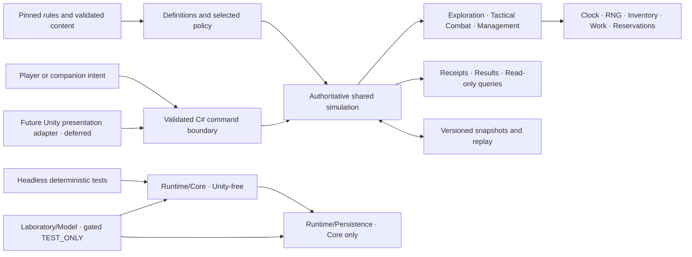

# Decennium C# simulation engine

**Development branch: [`Engine`](https://github.com/BordelonDevOps/DecenniumDescent/tree/Engine).** The owner requested a dedicated branch from `main` for all engine work. Source code, tests, Unity host source/settings and the related `docs/unity/` records belong on this branch. Generated caches, user settings and temporary build output remain ignored. The branch retains the rules repository inherited from `main`; no rules-source promotion is implied.

The owner-directed deliverable is a C# simulation for **direct exploration, tactical combat, and resource management over one shared world state**. Develop and validate the rules engine before Unity presentation integration. The engine remains incomplete; current feature coverage and validation evidence are in the [handoff](../docs/unity/DEVELOPMENT_HANDOFF.md) and [implementation trace](../docs/unity/IMPLEMENTATION_TRACE.md). Do not treat bounded `TEST_ONLY` profiles as complete production systems or release-approved content.

## Current architecture map



The simulation owns legality, elapsed time, random draws, state transitions, and committed receipts. Player input and companion AI submit through the same command boundary. Read models do not mutate authoritative state. Persistence encodes the records needed to resume and replay accepted commands; compatibility remains schema-versioned.

| Assembly | Responsibility | Dependencies and boundary |
| --- | --- | --- |
| `Decennium.Foundation.Core` | Simulation records, rule calculations, validation, command transactions, shared clock, random stream, inventory and work authority. | No assembly dependencies; no Unity references. |
| `Decennium.Foundation.Persistence` | Snapshot validation, versioned codecs and canonical command history. | References Core; no Unity references. |
| `Decennium.Foundation.LabModel` | Opt-in prototype procedures and finite synthetic fixtures. | Compile-gated by `DECENNIUM_TEST_ONLY` plus Editor/Development/Headless context; references Core and Persistence. Its test profiles are not production rule or content approval. |
| `Decennium.Foundation.Tests` | Headless deterministic regression cases compiled against the same package sources. | Exercises Core, Persistence and gated LabModel behavior; it is not Unity Editor or player-build evidence. |
| Unity Editor tools and laboratory host | Authoring and later presentation/qualification adapters. | Unity-facing code is isolated from Core. Decennium package import, player-facing scenes, Play Mode and builds remain deferred. |

## Current persisted increment: schema59 Map Route work

Schema59 adds a bounded, TEST_ONLY stationary Map Route work/check procedure to the shared simulation. Named workers reserve 480 active minutes through `WorkLedger`; shared `RuleClock` advancement, pause/resume and save/restore preserve exact work progress. The resolver credits final labor, processes boundary effects, revalidates the lead, then uses shared deterministic RNG/check logic and appends one causal Mapping result. Currently represented Poisoned state supplies disadvantage and both dice are persisted with the exact condition-journal prefix used at resolution, preventing later same-time events from rewriting the check. Incapable leads retain completed labor in `AwaitingCheck`; one-second synchronous handling fails closed near fractional work endpoints so the shared clock can complete them exactly. The route task does not close the route to unrelated travelers, and Mapping does not establish Unknown-passage feasibility. The full headless suite passes **1,225/1,225**; the primary, causal-history and fractional-boundary focused acceptances pass **1/1** each; the malformed negative-prefix regression passes **1/1**; static package validation passes **18/18 checks with 265 assets and 265 unique GUIDs**. GPT's excerpt-based review found no concrete blocker under the append-only condition-journal model. See the [Map Route work decision record](../docs/unity/ROUTE_MAPPING_WORK_RULE_DECISIONS.md), [current handoff](../docs/unity/DEVELOPMENT_HANDOFF.md), [implementation trace](../docs/unity/IMPLEMENTATION_TRACE.md) and [acceptance evidence](../docs/unity/evidence/2026-11-07-route-mapping-work/README.md).

The slice does not implement the full source Ready rule: spells, held concentration, movement, class abilities, arbitrary triggers and exploration trigger detection remain unsupported. Its three-actor one-hit-point combat target is a TEST_ONLY fixture assumption, not a balance rule. The Engine is still incomplete.

Unity **6000.3.28f1 LTS** is installed at `C:\Program Files\Unity\Hub\Editor\6000.3.28f1\Editor\Unity.exe`. After owner license activation, template creation at `UnityLaboratory/` completed with exit 0. This is environment preparation only: the foundation package has not been imported, and no Decennium scene has been generated. The earlier license failure is retained in [historical environment evidence](../docs/unity/evidence/2026-11-03-rolls/UNITY_ENVIRONMENT.json); the successful attempt is recorded in `engine/artifacts/unity-qualification-20261103T174953/01-create.json` and its adjacent log. Preserve this unused template while C# work continues.

Read [the handoff](../docs/unity/DEVELOPMENT_HANDOFF.md), [design and architecture boundaries](../docs/unity/UNITY_ENGINE_PLAN.md), and [requirements trace](../docs/unity/IMPLEMENTATION_TRACE.md). Unity is settled; production design choices remain under evaluation.

The [current conversion map](../docs/unity/IMPLEMENTATION_TRACE.md) accounts for all75 source areas and49 work items at pinned source revision `46a4d52728ee6956f0bebcb5d2103ffd5bc67ba4`. Current partial statuses are in the human trace; frozen JSON remains historical. Consult [Unity Rules Engine Development](https://chatgpt.com/c/6ae59513-3008-83e9-a5c4-8b6c5c5b4206) for product/source guidance, then the owner if both remain stuck. Safe intact vessel movement/custody is implemented in schema6 and a bounded fixed-roster scheduler in schema7. Schema8 now persists numerical actor/life state and automatic death/recovery. Source-complete spatial/attack legality and actual equipment/hands are the next integration dependencies. Owner-approved filling now runs in the schema5 host below. The owner-adopted ordinary handling, portioning and self-consumption profile now runs in the bounded schema4 host below.

`Laboratory/Model/PlaytestCharacters.cs` supplies ability modifiers, total-level proficiency, chronological base maximum HP and capacity-only clamping. It binds all 17 class Hit Dice, accepts recorded rolls or an explicitly chosen fixed average, and returns immutable calculation details. Hit Dice counts describe attained levels, not currently unspent dice. Full HP effects, character commands and grants remain separate work; schema8 below persists a bounded numerical profile. The kernel accepts `int` ability scores and uses `long` HP totals/current values to prevent overflow; arithmetic support does not establish character-generation legality.

For example, `BaseMaximumHp(new[] { new CharacterLevelRecord("Bard", 8), new CharacterLevelRecord("Bard", 5) }, 14)` returns base maximum 17. `ClampAfterCapacityChange(6, 17)` returns 6: a larger maximum does not heal. Call these static methods on `PlaytestCharacters` in the opt-in headless model. The ordinary test command below exercises the same implementation.

The owner selected **turn-based combat for the first prototype**. The first playable milestone must connect direct exploration, a tactical encounter and resource management through shared state. The compile-gated LabModel now exposes `RuleDice` for deterministic d20 selection through Core's `DiceStream` and `RuleResolution` for the existing provisional task, attack, ordinary-save and opposed-roll arithmetic. `PlaytestDice` and `PlaytestRolls` retain their compatibility surfaces and delegate to that shared code. This does not derive skills, proficiency, eligible modifiers or DCs; authorize commands; or apply effects. The procedures remain TEST_ONLY and release-disabled. See [the latest roll-resolution source bindings and validation](../docs/unity/evidence/2026-11-07-core-roll-resolution/README.md) and the [implementation trace](../docs/unity/IMPLEMENTATION_TRACE.md#2026-11-07--shared-gated-roll-resolution-service-no-save-schema-change). The legacy fixture retains schema1 and its existing behavior; a separately selected schema2 work fixture is described below.

## Run the checks available now

From the repository root, in a fresh PowerShell 7 process:

```powershell
pwsh -NoProfile -File engine/tools/Test-Foundation.ps1
pwsh -NoProfile -File engine/tools/Validate-Package.ps1
pwsh -NoProfile -File engine/tools/Validate-RuleBindings.ps1
```

The first compiles the same Core, Persistence, LabModel and regression sources into separate assemblies using PowerShell's bundled Roslyn and reference assemblies. It needs no downloaded SDK, Unity installation or network. It uses C#9 and treats warnings as errors; this is not a Unity compatibility test. The second checks package structure, GUID pairing and assembly boundaries. The third validates retained source bytes, all17 profile/340 RP cells, bound named cases and recorded tested-code hashes. Commands return nonzero on failure and retain JSON under ignored `engine/artifacts/`. Do not reuse a loaded PowerShell process after editing assemblies.

## Future Unity integration (deferred during the C# phase)

1. When Unity integration becomes the active phase, reuse the existing 6000.3.28f1 template project. The package's `unity: 6000.0` remains a minimum API declaration. Record actual project packages, target and scripting backend. The template's URP/2D renderer is a laboratory choice pending the game's visual evaluation; successful template creation does not validate the foundation package.
2. Use Package Manager's **Install package from disk** and select `engine/com.decennium.foundation/package.json`. Keep this repository location stable. Record the resulting project manifest and lock file; do not overwrite an existing project manifest. [Unity local package instructions](https://docs.unity3d.com/6000.0/Documentation/Manual/upm-ui-local.html).
3. Use **Decennium > TEST_ONLY > Enable laboratory for active target**. Wait for compilation. This adds only `DECENNIUM_TEST_ONLY` to the active target's existing defines.
4. Use **Decennium > TEST_ONLY > Create or open foundation laboratory**. The builder creates `Assets/DecenniumTestOnly/FoundationLab.unity` and `LaboratoryPanel.asset`. Running it again opens the existing scene without rewriting it. It asks Unity to handle unsaved scenes before switching. It does not add scenes to a build profile.
5. For tests, install/resolve an Editor-compatible Unity Test Framework in the host project and merge `"com.decennium.foundation"` into the project manifest's `testables` array. Do not guess a package version or replace other dependencies. Run Edit Mode `Decennium.Foundation.Tests.UnityFoundationTests`; expect the current shared suite count from the handoff, not zero. Preserve XML and Editor logs. [Unity package test discovery](https://docs.unity3d.com/6000.0/Documentation/Manual/cus-tests.html).
6. Enter Play Mode and perform the smoke sequence below. Record actual observations and new Console messages, including failures. These steps have **not** been executed in Unity here.

The package has seven asmdefs. Core and Persistence enforce No Engine References. Laboratory code requires the explicit define plus Editor or Development Build. Editor tooling and NUnit bridge are editor-only. New assets include `.meta` GUIDs; the USS metadata deliberately leaves importer-specific settings for the first real Unity import. Preserve GUIDs when that occurs.

## Scene and controls

Expected generated scene: `Assets/DecenniumTestOnly/FoundationLab.unity`.

Use the on-screen UI Toolkit **buttons with a mouse**. There are no keyboard, gamepad or production direct-control input maps yet.

| Control | Expected laboratory result |
| --- | --- |
| Left / Up / Down / Right | One abstract orthogonal step for the blue actor; walls and the orange companion block movement. |
| Open TEST_ONLY container | At the starting location, opens the adjacent gold square and transfers exactly one synthetic token. A second attempt rejects without changing state. |
| Advance one TEST_ONLY tick | Advances the integer fixture clock by one. Movement and interaction do not advance it. |
| Save fixture / Load fixture | Saves or restores snapshot, revision, receipts, clock and RNG state. |
| Recover primary from backup | Explicitly restores `.bak` after validation, retains `.bak`, and preserves the displaced primary as `.recovery-evidence-<id>`. Successful recovery allows saving again. |
| Start new TEST_ONLY fixture | Resets memory only. It does not delete or repair a disk save; Save remains blocked if the primary is corrupt. |

Blue is the actor; orange is the companion; gold is the container; gray is a wall. These squares are generated from Unity's white texture, with no imported game art.

Suggested smoke sequence: at startup open container, open again, attempt Right into the wall, move Left, advance a tick, Save, move again, Load, then leave/re-enter Play Mode. Verify expected rejection, position/state restoration, one token, and no duplicate UI/view objects. Disable/re-enable the laboratory component and reload the scene; inspect Console before and after. Test recovery using copies of laboratory saves only and record the preserved evidence path. Check UI readability at 1280x720 and resizing; visual correctness is currently unverified.

## Persistence limits

The laboratory saves to `Application.persistentDataPath/DecenniumTestOnly/foundation.ddsave`; UI diagnostics show the actual path. The previous successful snapshot is `.bak`. The first save has no backup. Loading a corrupt primary reports a failure, never silently resets or selects a backup.

The original Unity fixture retains schema1, content fingerprint `TEST_ONLY.lab-v1` and RNG identifier `xorshift32-v1`. The headless `TestOnlyWorkPolicy.Initial()` explicitly selects schema2 and `TEST_ONLY.work-session-v1`, with exact `RuleClock`, immutable work ledger and the versioned dice mapping. Its legacy tick field must stay zero. Schema1 golden bytes are preserved; no clock conversion or migration occurs. The same codec/store handles either format and refuses to overwrite a different schema/content/scope. Use a distinct save path for each fixture. Both have SHA-256 corruption detection, bounded fields and a maximum size of1MiB; schema2 allows at most256 records in each ledger collection as a technical bound. These are incomplete game-state models. Writes flush a sibling temporary file, decode it, then use same-volume replacement. This was exercised on this Windows host. Checksums are not authentication; filesystem crash durability, other platforms and hostile-save security have not been certified. The store requires one writer and a stable local path. No old browser-save migration or production save compatibility is promised.

Command receipts are scoped by trusted principal and command ID, persisted with state, and bounded at1,024 for schemas1–3 or512 for schemas4–8. On reaching capacity the lab fails closed until an explicitly new fixture; it does not evict receipts and risk awarding twice. The current implementation copies bounded snapshots for transactions and is not a production performance claim.

## Ordinary inventory and intake C# prototype

`TestOnlyInventoryPolicy` joins Camp Greens with the owner's adopted ordinary handling/portion/intake policies through the same `Simulation` transaction boundary. Schema4 stores exact ledger quantities, immutable parent/descendant provenance, ownership separately from custody, absolute freshness and persisted work. Every unit exists once in `WorkLedger`; descendants and consumption conserve the source amount. Zero-stock parents and settled reservation IDs remain recorded.

`PortionInventory` divides only unreserved quantity without elapsed time or physical movement. `HandleInventory` supports ready ordinary food pickup, drop at the prepared plot, stow/retrieve from a supplied open compatible pouch, and willing handover. Exploration handling books one active second for the donor and advances the shared crop/intake timeline through every nearer milestone. The final custody change preserves ownership and freshness. Current owner-use and recipient-consent grants come from trusted `Authority`, not payload claims, and still apply to retries.

`StartIntake` reserves ready food or potable water and actual exclusive worker time. Food consumes at900seconds/lb (600seconds per2/3lb), water at60seconds/pint. Each advance debits exact actual consumption and records recipient/lot credit. `InterruptIntake`, expiry and trusted combat entry release untouched stock and future labor while retaining consumed credit. A reservation does not stop aging. These records do not automatically settle daily needs, Strain or magical-meal benefits.

The fixture supplies two capable Medium STR10 actors, usable hands, one-pound open pouches verified to fit the finite initial ration bundle, the prepared plot/tools and a fixed four-pint waterskin with one-pound tare. Food pounds and potable-water pints use their documented unit mass for independent mass/Load checks. Harvested greens have no authored storage volume/shape here; stowing them rejects, even when their weight fits carrying limits. The fixed pouch and skin tares remain in carried burden when empty. Water portions remain in that same supplied skin: filling, pouring and intact vessel transfer reject pending their own physical-container implementation. The crop water source is suitable irrigation water, not implicitly potable. General equipment, hands/closures, production reach and movement remain outside this host.

`EnterInventoryCombat` is a host-only integration gate that interrupts intake and starts one actor's initial regular-turn interaction budget: one interaction, then one Action, with no per-operation elapsed charge. It offers no turn reset, clock advance, exit, attacks or complete encounter lifecycle. Known destructive hazards or scheduled mid-operation combat entries are not representable in this fixture; production integration must process them before advancing through such a boundary.

Schema4 uses ledger componentv2; schemas1–3 still requirev1 and preserve their old units and representation. Saves have no implicit migration or incompatible overwrite. Technical session bounds are512 receipts,128 rows in each ledger collection,128 provenance lots,32 intake jobs,64 handling records and the existing8 crops/32 tasks each. Hitting a bound rejects atomically. Maximum component counts fit the1MiB codec bound. Use `OrdinaryInventory.EdibleFood` for exact schema4 descendant totals; the old whole-pound crop projection explicitly rejects this schema.

The535-case suite includes farm→harvest8lb→pickup→portion2/3lb→handover retaining the companion's ownership→partial meal→save/restore→completion, plus fractional seconds, reservations, expiry, rollback, malformed histories, nested codec version/checksum guards and file-commit failures. This is headless C# evidence, not a playable Unity loop or full-engine completion.

## Ordinary water filling C# prototype

`TestOnlyFillingPolicy` explicitly creates schema5; it never migrates existing schema4 saves. `StartWaterFill`, `PauseWaterFill`, `ResumeWaterFill` and `CancelWaterFill` execute through the same authoritative transaction boundary. A declared source/quantity/destination reserves actual source water and destination capacity. Two usable hands and exclusive worker/opening access provide60active seconds, including ordinary opening/pouring/securing; a smaller quantity still requires the full minute. Pause retains progress and material/capacity claims while releasing unused labor. Cancellation retains elapsed work but moves no water. Completion releases its source claim and atomically moves the declared amount to a traced destination descendant; this creates no consumption or nutrition credit.

Physical vessel content rows reference existing ledger lots without duplicating quantities. The fixture has one4-pint skin carried by each actor and one supported1-pint ordinary flask at the prepared plot; each has1-pound empty tare, counted once. A separate finite32-pint clean pool supplies water. Each liquid lot retains original ownership and lineage even when the vessel has another owner. Source liquid, source vessel and destination vessel ownership grants are checked before retries; paused claims survive save/load. Filling can share elapsed time with another actor’s crop/intake work. Drinking and logical portions use the same actual contained water.

Schema5 adds at most8 vessels,128 content rows and32 fill jobs within the existing1MiB bound. Schemas1–4 remain byte-compatible in sampled legacy outputs. General vessel movement, nested storage, breakage/contamination, other liquids and tactical filling remain outside this host. Entering combat with any pending fill rejects until encounter transition rules are specified; no immunity to unsupported events is inferred. Current [source bindings](../docs/unity/evidence/2026-11-03-damage-dice/SOURCE_BINDINGS.json), [535-case results](../docs/unity/evidence/2026-11-03-damage-dice/HEADLESS_RESULTS.json) and [independent review](../docs/unity/evidence/2026-11-03-damage-dice/INDEPENDENT_REVIEW.md) define the actual qualification.

## Intact vessel handling C# prototype

`new TestOnlyFillingPolicy(movableVessels:true)` explicitly creates schema6. `HandleVessel` accepts one intact readily accessible securely closed skin/flask for pickup, supported plot drop or willing handover. Exploration costs one active second; tactical handling shares the existing ordinary interaction/Action allowance with food handling. The vessel and all contents move together without creating liquid descendants, merging histories, consuming water or transferring ownership. The recipient’s complete burden includes each vessel tare and remaining contents once, including empty vessels.

Current grants for the vessel and every positive contained lot’s owner, recipient consent, usable hands, reach and carrying limits are checked. Pending source/destination fill claims, including paused capacity claims, and contained intake reservations gate ordinary vessel movement. This path does not cancel jobs or establish a universal immovability rule. Filling requires two hands; ordinary intact handling uses the fixture’s one available handling hand. General storage, open-vessel hazards and contested movement remain outside the supplied safe arrangement.

Immutable command-ordered movement records preserve old custody for completed filling/intake histories after later transfers. Same-clock tactical moves use committed revision order without arithmetic overflow. Historical physical quantity derives from original amounts, descendant creation and actual consumption. Actor position history and arbitrary access are not reconstructed. Up to64 movement records fit the existing1MiB save bound; capacity exhaustion rejects atomically. All older schema meanings remain unchanged, with no migration or incompatible overwrite. The535-case suite includes23 vessel cases and the complete fill→handover→drink→save/resume path.

## Exact life recovery timing

`LifeState.StableUntil` retains an exact rational deadline. `StabilizeAt`, `DamageAt`, `DeathSaveAt` and `StableRecoveryAt` accept `RuleTime`, preserving fractional initiative phases through the existing one-to-four-hour Stable recovery delay. Buffered damage, prohibited recovery and non-HP state changes preserve the original deadline; actual healing or qualifying damage ends it under the existing rules.

The original whole-second methods delegate to the same implementation. `StableUntilSeconds` returns whole deadlines and explicitly rejects fractional ones, preventing silent truncation. Competing deadline representations and unrepresentable rational results reject. Twelve exact-life cases extend the shared suite to478. That earlier helper increment changed no snapshot schema; schema8 below now integrates bounded actor persistence and automatic death/recovery dispatch.

## Fixed-roster encounter C# prototype

`new TestOnlyEncounterPolicy(resolvedOrder)` explicitly creates schema7 with one or two capable nonsurprised fixture actors. The supplied resolved order is immutable and fingerprinted; initiative rolls and tie choices are not replaced by an automatic sort. `BeginFixedEncounter` preserves the clock, interrupts actual intake and rejects pending filling or incompatible roster labor. `EndRegularTurn` requires the current actor and exact turn identity, completes one equal slot and begins the next. The same order repeats every six seconds, using exact rational times with no extra time at round wrap. Independent companion crop work continues on the shared timeline.

The current turn has one free object interaction and one ordinary Action. `EncounterDash` pays that Action and exposes its movement allowance; a second object interaction uses the same Action. Spatial movement remains gated. Turn starts refresh these two allowances; ending a turn needs no unused Action. Older food/vessel transfers retain their actor and timestamp, and combat-interrupted intake retains the original entry time.

The saved record includes origin, resolved order, up to128 completed regular starts and paid Dash history. Boundaries and actions must each match their own committed command receipt. Future revisions, revision collisions, unrelated receipts, missing spending records and gaps in post-entry receipt coverage reject on restore. Receipts check structural consistency and do not authenticate edited saves. The535-case suite includes25 encounter regressions; maximum schema7 component counts fit the existing1MiB bound. All previous schema encodings stay unchanged, without migration.

This host has no actor effects, attacks, surprise, reactions, extra turns or end-round events. It therefore does not execute those boundary procedures, and cannot admit content needing them. Roster changes, encounter exit, full character/life persistence and general spatial legality remain separate work. The scheduler is a tested C# integration increment, not complete tactical combat.

## Quantity and carrying C# helpers

`RuleQuantity` preserves exact nonnegative rational amounts without implicit units or rounding. `PlaytestCarrying` implements the reviewed provisional size/Strength table, independent pounds and Load, Burden/push-drag speed arithmetic and body/casualty weights. Known overload rejects; an unknown measure never becomes zero. Load-derived hauling pounds are labeled estimates and cannot supply documented physical mass.

`BurdenItem` records the exact contents covered by each inclusive quantity independently. Nested containers count each physical object once per unit. The bounded helper accepts up to256 objects; cross-unit fallback is atomic only. If an inclusive aggregate lacks the other unit, that unresolved total remains unknown. Partial overlap requiring empty-item decomposition rejects; documented whole-root totals may still cover consistent crossing child aggregates. These are numeric helpers, not an inventory owner, transformation system or permission to move/consume goods.

## Camp Greens C# prototype

`TestOnlyCropPolicy.Initial()` explicitly selects schema3 and a distinct fingerprint. `CampGreens` executes the approved one-hour planting,15-minute tending, seven days of suitable/cared growth and one-hour harvest procedure. Seed/water spend once, interrupted active work retains progress, passive growth releases the worker, and advances stop at the earliest crop milestone. Exact maturity, neglect, harvest and freshness boundaries follow [owner decisions](../docs/unity/PROTOTYPE_RULE_DECISIONS.md).

The bounded host supplies one prepared10x10-foot plot, a capable companion and compatible tools. Production acquisition, routes, seasons, carrying, food use and autonomous assignments are not supplied. Use its trusted host grant for crop commands and condition changes; the command payload cannot grant world authority. Save schema3 to its own path. History bounds are8 crops/plots/foods,32 tasks per crop and128 ledger records per collection, with no silent eviction or migration. The shared test suite exercises this host headlessly; the existing Unity scene still runs the original schema1 fixture.

## Release exclusion

For a non-development build, remove `DECENNIUM_TEST_ONLY` from that target and exclude all laboratory scenes from its build profile. The unconditional Editor gate rejects a release build retaining that define or a `DecenniumTestOnly` scene / `TEST_ONLY` root. The laboratory asmdefs and source guards exclude fixture implementation from release compilation; the core also rejects TEST_ONLY snapshots in Release profile.

The guards exist and the core rejection is tested headlessly. **Actual development/release builds, stripping and scene exclusion have not been exercised.** Before any release claim, verify both a rejected contaminated build and a clean build with no laboratory assembly/content. This package is not release content approval.

## Persisted actor life C# prototype

`TestOnlyActorLifePolicy` explicitly creates schema8 with two Medium/STR10 numerical fixtures. Six ability scores, chronological class/HP facts, normal/temp HP, linked Wounds, death counters, exact recovery deadlines, regular death-save markers and Prone survive save/load. These facts do not claim complete class creation or feature grants.

First and later regular starts perform exactly the required death-save d20 and, only on a third ordinary success, one recovery d4. Natural20 restores1HP without standing up. The shared clock recovers all due Stable actors at the exact deadline, including companions outside the roster, before an incoming death save. Incapable actors cannot Dash or work; host clock and regular-turn progression remain available.

The profile explicitly supplies empty hands and no independent conditions, effects, survival replacements or reactions. It admits crop work and automatic life transitions; attacks, physical movement, standing, inventory handling, intake and filling are gated in this profile. Earlier inventory hosts remain available separately. The host cannot yet inflict damage or drop held equipment.

Restore replays canonical contiguous accepted commands from the fingerprinted initial fixture and compares exact life records, clock, RNG and ordered event revisions. This rejects forged rolls, counters, deadlines, historical Dash eligibility and recovery attached to the wrong clock interval. Existing crop invariants remain separate; no complete world replay, save authentication or authority reconstruction is claimed.

The535-case suite includes25 new actor-life cases. Structural schema8 limits fit a2MiB envelope (maximum fixture1,199,243 bytes); schema1-7 encodings and1MiB bounds remain unchanged. There is no implicit migration.

## Planar combat constraints

`CombatCell` explicitly means an aligned five-foot combat tile; no existing synthetic world coordinate is converted implicitly. `PlanarCombatGeometry` supplies the source's equal orthogonal/diagonal distance, single-step corner constraint, strongest cover result, inclusive normal/long range and close-hostile ranged disadvantage. Total cover has no finite AC bonus and prevents direct targeting through that obstruction.

These independent constraints still require actual visibility, known location, line of effect, occupancy and weapon/character legality from the authoritative caller. A range or corner result alone never authorizes an attack or movement. Thirteen regressions bring the shared suite to516, with no save-format change.

## Conditional damage dice and knockout choice

`PlaytestDamageDice` wraps the existing ordinary post-defense life procedure with conditional normal Wound d20, linked Injury d6 and successful-knockout recovery d4 draws. Instant Death and fatal Wounds stop later dice and choices. `AskIfEligible` returns an immutable `PendingKnockout` with captured inputs and rolls but no final life outcome. Completing it never rerolls prior results; choosing ordinary outcome consumes no additional die. An early conditional knockout instruction produces the same result as the later choice.

This procedure still needs an authoritative host to persist the continuation, verify the attacker's authority, retain Action/RNG spending, block unrelated advancement and apply actual condition/custody consequences. It admits no feature-based damage prevention or modified Wound saves. Eighteen damage cases extend the suite.

`PrototypeArmor.UnarmoredBaseAc` applies the [owner-adopted ordinary unarmored baseline](../docs/unity/ORDINARY_ATTACK_RULE_DECISIONS.md):10 + Dexterity modifier. Specific sourced formulas and modifiers are separate. One additional regression brings the shared total to535. No snapshot schema changed.

## Bounded Club command integration

`TestOnlyClubAttackPolicy` uses explicit schema9. Two numerical Medium actors hold distinct Standard Clubs on aligned five-foot cells. Unarmored AC uses the owner-adopted baseline. Fixed character facts give STR/DEX/CON10 and maximumHP26; this is not full Warrior acquisition and grants no Club or save proficiency. Sight, line of effect, support and lack of operative defenses/features are explicit fixture facts.

Each conscious actor selects a stance on its own regular turn before an attack or End. Previous stance expires at the next own Start. Aggressive applies its flat damage once and AC penalty; Guarded applies AC. Mobile/Focused can be selected, but movement/spell/reaction operations are unsupported. Carrying rejects without an applicable cargo penalty. Attack and Dash spend the same ordinary Action. Club hits arm Press through the next own Start; following is still gated.

`AskIfEligible` records a paid attack with retained rolls and a pending attacker choice. It freezes unrelated commands until `ResolveKnockout`; save/load resumes without reroll or repaying. Current actor control gates the chooser; current weapon-owner permission gates attack and attack retry. Eligible knockout draws its recovery d4 once. Unconsciousness drops only held Clubs, preserves title/custody and leaves carried inventory in place; recovery retains Prone and does not pick up dropped weapons. Still-unconscious/dead actors may End without an invented default stance; automatic recovery is checked first.

Canonical contiguous command replay validates outcomes and all unchanged background stock. Schema9's maximum structural test is1,331,355 bytes within2MiB. Schema1-8 golden outputs remain unchanged; no migration. This increment adds32 cases, reaching567/567;8 package checks and source binding validation also pass. Evidence: [source bindings](../docs/unity/evidence/2026-11-03-club-attacks/SOURCE_BINDINGS.json), [review](../docs/unity/evidence/2026-11-03-club-attacks/INDEPENDENT_REVIEW.md). No movement, standing/pickup, other weapons, general conditions/reactions, defenses, encounter exit or Unity qualification is claimed.

## Condition projections

`PlaytestConditions` adds bounded calculations over14 explicitly supported unsuppressed clause families. It covers cumulative Exhaustion, Speed changes, Dazed/Incapacitated/Staggered constraints, ordinary condition attack modifiers, Corrupted restoration amounts and Petrified resistance. The Core Invisible location endpoint is distinct from actual sight; critical-if-hit never converts a miss into a hit. Existing standing/crawling budgets remain shared.

`RecomputeExhaustionCapacity` only changes capacity and clamps HP downward. `ChangeExhaustion` takes previous/current levels and kills only on a new transition into6. Repeating level6 or recalculating capacity cannot re-kill a surviving collapsed state; removing Exhaustion does not resurrect or heal. The caller must supply the otherwise-applicable maximum with this factor excluded; this is not the combined systemic-multiplier ledger.

These projections supply constraints, not permissions to perform an otherwise illegal action. They do not adjudicate source-linked applications, component immunities/suppression, durations, cures, one-time inherited Prone/drop or independent condition causes. They are not installed into schema9. The24 named cases and4,200 Exhaustion samples bring the suite to591/591; [source evidence](../docs/unity/evidence/2026-11-03-condition-projections/SOURCE_BINDINGS.json) retains limits. No save schema or Unity execution changed.

## Saved posture and movement expenditure

Supplying both explicit `actorBaseWalkingSpeed` and `companionBaseWalkingSpeed` to the bounded Club policy selects schema10. Omitting both preserves schema9. These are supplied fixture facts, not a universal30-foot movement rule. Current Speed applies Guarded, Mobility Trauma and Critical penalties once as appropriate, and becomes zero for the host's dead/HP-Unconscious actors.

`StandFromProne` uses floor(half current Speed), requires a selected stance, nonzero Speed and remaining budget, and spends no Action. `DropProne` costs no movement, leaves held equipment intact and can precede stance selection because it invokes no stance benefit/restriction. Neither moves cells, consumes Mobile travel allowance or opens a departure-triggered OA/Press window. Paid Dash expands the cap while retaining expenditure; own regular Start resets that actor's movement. Save/replay includes actual posture, immutable base Speed, turn marker and spent cost.

Twenty cases bring validation to611/611. Maximum structural schema10 is1,338,783 bytes;54 overlapping schema1-9 saved outputs remain unchanged. [Evidence](../docs/unity/evidence/2026-11-03-posture/SOURCE_BINDINGS.json). General movement, unarmed/OA continuations, Press following and independent cause-aware conditions remain separate dependencies. Those proposals were subsequently adopted and implemented in the explicit schema11 profile below. No Unity execution.

## Maximum HP and historical thresholds

`PlaytestMaximumHp` calculates reviewed source magnitudes, retains level/acquisition/creation inputs, selects compatible application records and applies the strongest global Monk reduction. Exact rational time plus source phase preserves same-instant application/expiry order; suppression never pauses a deadline. Completed target rests remove the supplied default trauma endpoints while preserving explicit-only endpoints and unrelated effects.

Expedition Strain and Exhaustion multiply against the same otherwise-applicable maximum before one floor. The shared capacity clamp preserves normal HP except downward overflow, temporary HP, Wounds, death counters and exact Stable deadlines. Capacity changes cannot become damage, healing, first-fall triggers or lethal track transitions. Frozen HP event records support exact thresholds, actual downward crossings, actual healing exits and historical below-half damage; source-frequency eligibility remains separate.

31 added cases bring the full suite to642/642. Both the C# systemic grid and original Python reference cover909 states; the Python validator also passes60 checks. [Evidence](../docs/unity/evidence/2026-11-03-maximum-hp/SOURCE_BINDINGS.json). No schema, acquisition, companion lifecycle, event dispatch or Unity extension is included. Legal source eligibility and one actual effect identity across textual aliases remain caller responsibilities. Those proposals were subsequently adopted; schema11 below implements the bounded policy.

## Tactical movement, ordinary unarmed and reactions

Supply explicit walking Speeds and `TacticalCombatFixture` to `TestOnlyClubAttackPolicy` to select schema11. The optional third numerical humanoid enables competing reactions and nested follows. This fixture explicitly supplies five-foot cells, terrain, clear adjacent melee sight/line of effect, mutual hostility and usable striking anatomy. It grants no proficiency or class features. Default schema9 and posture schema10 retain their original fingerprints and encodings.

`TacticalStep` announces a fixed neighboring destination. Eligible ordinary OA controllers respond in captured initiative order before departure, with eligibility rechecked. Accepting spends the reactor's Reaction; declining preserves it. An attack can open the existing knockout choice owned by its attacker. An interrupted step spends no movement, while resolved attacks, rolls and spent Reactions remain committed. The next own regular Start refreshes Reaction; a round boundary alone does not. Focused immediately prohibits ordinary OA. Disengage spends the Action and protects only that turn. Mobile tracks actual first-five-foot travel across ordinary movement and Press; standing and extra terrain cost are not distance.

Press is offered only after actual adjacent-to-nonadjacent departure. Its accepted follow consumes the interval entitlement immediately and uses a separate five-point cost allowance. Its own OA can interrupt travel without refunding that entitlement. Competing followers use application order and revalidate the vacated cell; nested follows finish their own choices first. Finite consumed entitlements prevent a chain from refreshing itself. The attacker can precommit `ArmOrReplace` or `KeepExisting` on a qualifying hit; preserving an empty state is allowed. The selector survives receipt identity, pending knockout and replay. This pre-roll choice timing is a recorded consensus completion under the owner's delegation.

Ordinary unarmed uses the adopted STR/flat-bludgeoning contract. The numerical STR10 fixture deals 1 damage, or 3 with Aggressive, without a damage-die draw or critical doubling of flat damage. Actual usable fist/elbow/knee/foot/head options require no free hand when another part can strike. The generic helper validates these options; the fixture supplies their availability rather than claiming a condition/anatomy system.

41 new cases bring the full C# suite to **683/683**; all 8 package checks pass. All 56 overlapping schema1–10 saved outputs remain byte-identical. Structural maxima occupy 1,827,755 bytes within the existing 2 MiB envelope. The host reserves history space for an entire possible continuation before accepting a root step; it never evicts past events or silently truncates a paid reaction. [Source bindings and evidence](../docs/unity/evidence/2026-11-03-tactical-movement/SOURCE_BINDINGS.json) include exact source bytes, owner/delegated policy, independent review and tested hashes.

This remains a bounded C# host. It does not implement arbitrary characters, general visibility/hostility, nonroster reactors, general equipment/body capability, other weapons, spells, Ready/Interpose, condition lifecycle, roster changes, encounter exit or the complete connected exploration-management game loop. Unity integration remains deferred.


## Source-aware condition lifecycle

`ConditionLedger` retains separate immutable application and immunity records, owner/source/target identity, explicit ending methods and exact `EffectClockMarker` deadlines. Its 14 admitted generic non-track condition identities feed `ConditionView` and the existing calculation helpers. Same-name penalties apply once while independent sources retain separate suppression, expiry and cure histories. No default duration, DC, save, action cost or refresh is inferred.

Initial named immunity prevents an application or inherited component; later immunity suppresses an admitted component while its clock continues. Eligible cures include suppressed records. Incapacitated can be cured independently from its parent, with admission prevention and later removal recorded separately. Operative Petrified supplies its own Poisoned-immunity provenance. Exact advancement captures intermediate concentration-loss instructions even when the condition expires before the final time. The life-permission bridge preserves zero-HP and death restrictions.

A lawful new Unconscious application emits drop-held-items and, unless prevented, fall-Prone instructions once. Its Prone record survives the parent and can be removed independently. Direct Prone also emits a fall instruction; resuming suppression never repeats old onset. The host must atomically commit state and consequences after command authorization and provide persisted idempotency. This helper does not mutate held equipment, concentration or life state. New policy completions are recorded in [the delegated consensus receipt](../docs/unity/CONDITION_LIFECYCLE_RULE_DECISIONS.md).

Forty new cases, including a 1,024-state component grid, bring the shared suite to **723/723** with all 8 package checks passing. All 60 overlapping schema1–11 saved outputs remain byte-identical; no save schema changed. [Source bindings and review](../docs/unity/evidence/2026-11-03-condition-lifecycle/SOURCE_BINDINGS.json) retain the exact limits. Condition persistence and authoritative command integration are next. Relationship conditions, numeric tracks, periodic Bleed/fire families, Staggered's episode/rider, source-specific application legality and hard-denial caps remain separate work. Unity integration remains deferred.


## Condition history component persistence

`ConditionJournal` holds immutable typed operations, exact time/phase, target, explicit rule-policy identity and unique operation IDs. Same-marker operations retain their original order. Prevented attempts remain in the journal even when the lifecycle admits no application record. Its independent 512-operation bound rejects overflow without evicting history. Core records are structural data; they grant no source or command authority.

`ConditionJournalCodec` version1 supplies a deterministic checksummed component envelope, strict lengths/tags/flags, canonical rational and immunity-set encoding, and trailing-data rejection. `ConditionHistory.Restore` validates the selected provisional interpretation by replaying every operation through the existing ledger. Restore returns state only; appending afterward returns only that new operation’s consequences. Old drop, fall and concentration instructions never become pending work merely because a component was loaded.

The host still must bind operations to command receipts and legal sources, persist actual world consequences with the component atomically, and revalidate current combat restrictions. The component is not attached to `Snapshot`, the gameplay store or combat commands, and its checksum is not authentication. Semantically invalid but structurally valid histories require interpreter rejection. Existing schemas1–11 remain unchanged; no migration is introduced.

Twenty-three cases include a 256-state parent/component persistence grid, exact phased expiry, suppressed cures, prevented attempts, no replayed onset, malformed payloads, history-capacity rollback and disk component resume. The structural maximum of998,152 bytes fits the1MiB component envelope. The shared suite passes **746/746**, with8 static package checks. [Evidence and source bindings](../docs/unity/evidence/2026-11-03-condition-journal/SOURCE_BINDINGS.json). No new mechanics or rule approvals were needed; Unity integration remains deferred.


## Condition combat host (schema12)

Selecting `ConditionCombatFixture` alongside the tactical fixture enables fixed, fingerprinted condition events, exact absolute phase-zero clocks and one journal per admitted actor. `DispatchConditionEvent` requires world authority and control of its target. Events bind an immutable operation, target and trigger time; this API grants no player spell, source acquisition or arbitrary condition payload.

Conditions now affect actual command legality, sight-dependent OA, attack advantages/criticals, Petrified mitigation and paid movement. Journal updates commit with physical posture, dropped held Clubs and continuation invalidations. Zero-HP and external Unconscious causes remain independent. Known locations do not grant sight; concentration and phased turn endpoints remain outside this fixture.

The adopted safe-choice event contract revalidates captured OA/Press offers without undoing paid attacks or accepted Press entitlements. Pending knockout completion remains atomic. Full receipt replay verifies the final journal and physical world together; restores never reissue old consequences. Receipt and condition-history guards preserve room to finish pending choices. Three-actor support, mandatory stance choices under Action restrictions and history exhaustion have explicit regressions.

Schema12 uses a6MiB aggregate envelope for up to three condition journals. Older schemas retain their original limits and encodings;62 overlapping saved outputs are byte-identical. The782-case shared suite and8 static checks pass. [Evidence](../docs/unity/evidence/2026-11-03-condition-combat/SOURCE_BINDINGS.json). General exploration/encounter transitions, full job/content execution and Unity integration remain unfinished.


## Shared exploration and management (schema13)

`TestOnlySharedWorldPolicy` composes existing farming, water, food, inventory and condition procedures with exact cardinal-edge traversal and a persistent fixed activity calendar. The calendar starts once at world creation. It has a deliberately shortened initial interval for later actors, preserves paid Dash and exact movement spending, and skips empty intervals analytically without banking allowances.

`BeginWorldStep` starts a supplied five-foot cardinal edge with `walk` or `run`. `AdvanceClock` credits actual movement and compatible companion work to relevant boundaries; `SuspendWorldStep` and `ResumeWorldStep` retain exact partial position. A condition can stop the actor two feet along an edge, without snapping or refunding time. Explicit resume revalidates ability and any new Dash payment. The remote companion starts with both hands free, its Club grounded at the plot. Actual held Clubs prevent two-hand filling.

The820-case suite includes a real explore/grow/harvest/pickup/intake/save/explore loop, a seven-day farming calendar and condition interruptions. Full receipt replay compares every canonical persisted subsystem, including reservations and nested crop work. LabModel references engine-free Persistence for this equality projection; Core remains independent.65 overlapping previous saved outputs are byte-identical. Structural closed-encounter history is retained separately from the current pointer; it does not authorize restarting a continuing encounter.

This increment does not yet connect tactical combat to the shared host. Hostile approach/departure, simultaneous hostile traversal, off-grid access/drop and synchronous handling across a condition deadline are explicitly gated. Damage, outside dying, changed rosters, general traversal/content and Unity remain unfinished. [Decisions](../docs/unity/SHARED_WORLD_RULE_DECISIONS.md) and [evidence](../docs/unity/evidence/2026-11-03-shared-world/SOURCE_BINDINGS.json).


## Connected tactical control (schema14)

`new TestOnlySharedWorldPolicy(new SharedCombatFixture())` explicitly selects the connected host. Calendar slots and actual command observations are independent: day-seven entry needs one observation at slot204000. Entry keeps exact exploration spending and does not repeat processed Start effects. `BeginFixedEncounter` enters from supplied grid anchors; an authored hostile approach enters before departure. A pending exploration edge remains an explicit entry gate.

The existing tactical command path supports Club/unarmed attacks, standing, movement, Dash, Disengage, OA, Press and knockout choices on the same interval budgets. Mobile remains gated pending continuous distance integration. Tactical decisions pause world time; `EndRegularTurn` advances to the next actual boundary. `EndFixedEncounter` requires the fixture's hostile Dead and no pending choice, completes that outgoing slot, then returns to exploration. Encounter identity persists through reentry.

Participant work pauses or interrupts under its existing procedure; remote compatible companion work advances with actual elapsed time. The837-case suite includes the full explore/fight/exit/grow/harvest/acquire/eat/save/load/explore path, exact-boundary expiry/save/entry, fractional movement cost, filling reservation continuity and pending OA disk restore.69 prior saved outputs remain byte-identical. Outside-dying qualification, changed rosters, general source acquisition/content and Unity remain unfinished. [Decisions](../docs/unity/CONNECTED_COMBAT_RULE_DECISIONS.md) and [evidence](../docs/unity/evidence/2026-11-03-connected-combat/SOURCE_BINDINGS.json).


## Formula research and copying (schema15)

`new TestOnlySharedWorldPolicy(new SharedCombatFixture(), new SharedResearchFixture())` adds one supplied Alchemy5 researcher and exact public recipe-4 knowledge work. `StartFormulaResearch` selects an authored evidence identity and method; it earns8active hours and resolves one Core task check. Failure retains notes and the failed evidence/method pair. A permitted retry needs its full new duration; a new command label cannot authorize one. Success records exact formula knowledge, without manufacturing its product or granting XP.

`StartFormulaCopy` reserves an actual1sp writing allotment and consumes it once on first positive work. It finishes after1active hour without a roll. Both procedures retain feasible work after pause or interruption; cancellation keeps historical expenditure and transfers no credit to another attempt. `PauseFormulaWork`, `ResumeFormulaWork` and `CancelFormulaWork` use the persisted attempt identity. The supplied worker has two legal8h windows only; no unlimited labor or rest benefit is inferred.

After final labor and the established condition/recovery/life boundary, incapable research persists `AwaitingCheck`. Explicit legal resume resolves the original check without further hours or a new labor window. Fully written copying completes once despite endpoint incapacity. All formula commands wait for pending KO/OA/Press choices to resolve. The864-case suite includes these boundaries, exact reservations, retries, current inventory grants, remote tactical work and disk continuation.73 earlier saved outputs remain byte-identical. The native phase component tracks retained work and actual labor separately, including manufacturing's lost unfinished phase; no crafting executor is claimed. [Decisions](../docs/unity/FORMULA_RESEARCH_RULE_DECISIONS.md) and [evidence](../docs/unity/evidence/2026-11-03-formula-research/SOURCE_BINDINGS.json).


## Crafting consequences (schema16)

An explicit `SharedCraftingFixture` adds finite host-authored occurred mishaps to `TestOnlySharedWorldPolicy(combat, research, crafting)`. `DispatchCraftingMishap` is host-only and binds exact lead, original participants, time and settled table result. This consequence harness does not yet execute manufacturing inputs, quality/mishap selection, XP or output.

The actual Alchemy accident rolls1d4 acid through damage/Wound/life and physical drop/prone. Outside tactical control, a calendar actor uses its next genuine Start; the remote companion persists onset+6second markers. Condition expiry, Stable recovery and due death saves have explicit order. Logical due identity persists separately from global audit sequence. Entry and restore grant no extra save or series. Independent conditions and paused work remain independent after healing.

The actual ordinary kit has a supplied wooden structure,5HP,50gp baseline and8lb mass. Compatible mishap damage needs no Sunder roll; poison/psychic immunity remains. Broken retains identity/location/ownership/custody/mass and prevents actual tool-dependent research. No passive repair exists.

`StartCraftRemedy`/`PauseCraftRemedy` address incident obligations. One cleaner, one proficient recalibrator or the original log author performs the appropriate fixed labor; only fouling permits simultaneous eligible cleaners. Exact person-seconds survive interruption, and current work windows/owner grants/exclusive reservations are enforced. Internal generated job identities prevent source event names from cancelling unrelated work. Final earned labor completes without an invented endpoint check. All new commands wait for pending tactical choices.

That checkpoint passed894 C# cases, including30 consequence cases and three actual disk scenarios;75 overlapping prior outputs remained byte-identical. Independent review ran27 focused nondisk cases and verified113 compiled hashes. [Decisions](../docs/unity/CRAFTING_CONSEQUENCE_RULE_DECISIONS.md) and [evidence](../docs/unity/evidence/2026-11-03-crafting-consequences/SOURCE_BINDINGS.json).

## Actual tool repair (schema17)

`TestOnlySharedWorldPolicy(combat, research, crafting, repair)` opts into a finite physical-case repair using separate Carpenter's tools and two actual compatible material allotments. Start/pause/resume/cancel commands retain exact labor, debit materials on first positive work and restore the existing maximumHP only on a successful DC10 tool task. Full labor with endpoint incapacity persists AwaitingCheck, retaining the target claim without more worker hours. Current owner grants are resolved before idempotency. Canonical replay verifies actual HP, spending, reservations and RNG.

Active repair excludes research/recalibration using that target; atomically interrupted jobs retain earned work and resume explicitly. The supplied bench permits different workers to copy and repair in compatible work areas. Schema17 copying no longer requires an Alchemy kit, and actual repair/research checks include strongest applicable linked Injury penalties. Legacy16 semantics remain unchanged for old saves. Structural success preserves identity, custody, mass and outstanding incident debts.

924/924 C# cases pass, including30 new cases and two actual disk scenarios. Independent review ran28 nondisk cases, closed two reproduced defects, verified117 final compiled hashes and restored an authentic5277-byte old16 save identically across DLLs.78 overlapping prior saved outputs remain byte-identical. General manufacturing, actual product use and the full engine remain unfinished. [Decisions](../docs/unity/TOOL_REPAIR_RULE_DECISIONS.md) and [evidence](../docs/unity/evidence/2026-11-03-tool-repair/SOURCE_BINDINGS.json).


## Bounded manufacturing and product use

Explicit schema18 selects one exact reviewed Alchemy recipe and existing formula. Its fixture supplies the trained pre-specialty worker, two finite sets of source-identified components, a few compatible vials and the qualified fortified-camp station. Commands reserve the whole order, retain exact phase/labor progress, preserve Black Blood's original clock through stabilization and pause at exact spoilage. A completed but temporarily incapable check waits without repeating labor; its one roll, quality and any later choice survive save/load.

The saved order executes the recipe's reviewed quality bands, choices, yield and potency; exact catalyst and divisible/indivisible failure recovery; progression/findings; and all six mishap consequences through the existing shared world incident system. It creates physical dose/vial records with recipe, maker, custody, location and mass. One bounded tactical use pays an Action and healing dice, revalidates permission/ingestion/reach and preserves the actual empty container. Exact scope is in [the manufacturing receipt](../docs/unity/MANUFACTURING_RULE_SCOPE.md); all bound sources, 29 new cases and save parity appear in [the evidence](../docs/unity/evidence/2026-11-03-manufacturing/SOURCE_BINDINGS.json).

The shared suite passes **953/953** and all8 package checks. All78 overlapping prior save outputs remain byte-identical; no schema1–17 migration occurs. Other recipes, profession/training acquisition, general ingredient/market sources, stations and product effects remain outside this fixture.
